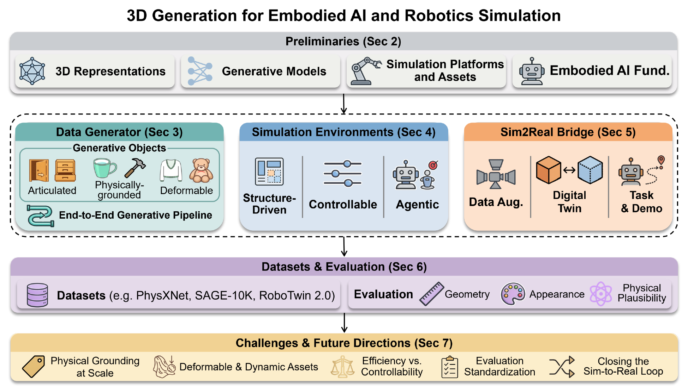

# 🤖 Awesome 3D Generation for Embodied AI

[](https://awesome.re)
[](https://3dgen4robot.github.io)
[](https://arxiv.org/abs/2604.26509)
[](https://github.com/hitcslj/3DGen4Robot)

A curated list of papers, datasets, benchmarks, simulators, and evaluation resources for 3D generation in embodied AI and robotic simulation.

This repository accompanies our survey on **3D generation for embodied AI and robotic simulation**. It organizes the literature around how generative 3D methods support embodied systems, from simulation-ready asset creation, to interactive scene generation, to sim-to-real transfer. In addition to research papers, we collect resources that are useful for building and evaluating embodied 3D generation systems, including datasets, benchmarks, simulator platforms, and asset formats.

Contributions are welcome. Please open an [issue](https://github.com/hitcslj/3DGen4Robot/issues) or submit a [pull request](https://github.com/hitcslj/3DGen4Robot/pulls) if you would like to add a paper, dataset, benchmark, simulator, or evaluation resource.

## ✨ Highlights

- 🧭 Survey-driven taxonomy for **3D generation in embodied AI**
- 📚 Curated coverage of **papers, datasets, benchmarks, simulators, and evaluation**
- 🦾 Emphasis on **simulation-ready** assets and environments rather than visual realism alone

## 📢 News

- **[2026-10-24]** 🔥 **v2 update**: we added 84 new papers, marked with 🆕.
- **[2026-04-29]** 🚀 Our survey is released on [arXiv](https://arxiv.org/abs/2604.26509), together with this paper list and the [project page](https://3dgen4robot.github.io).

## 📑 Table of Contents

- 🧭 [Scope and Taxonomy](#-scope-and-taxonomy)
- 📚 [Awesome List](#-awesome-list)
  - 🧩 [Data Generator](#-data-generator)
  - 🏠 [Simulation Environments](#-simulation-environments)
  - 🔄 [Sim2Real Bridge](#-sim2real-bridge)
- 📊 [Datasets and Benchmarks](#-datasets-and-benchmarks)
- 🎮 [Simulators and Formats](#-simulators-and-formats)
- 📏 [Evaluation](#-evaluation)
- 🤝 [Contributing](#-contributing)
- 📝 [Citation](#-citation)

## 🧭 Scope and Taxonomy

<p align="center">
  
</p>
<p align="center"><em>Outline of the survey: built on the preliminaries, three core modules (Data Generator, Simulation Environments, Sim2Real Bridge) cover object-level asset creation, scene-level environment synthesis, and the sim-to-real transfer loop, followed by datasets, evaluation, and open challenges.</em></p>

We focus on 3D generation methods that are useful for **embodied AI**, **robot learning**, and **robotic simulation**. Compared with general-purpose 3D generation, embodied settings require more than visual realism: generated assets and environments should be executable, physically meaningful, interactive, and compatible with simulation platforms.

We organize the field into three major roles:

1. 🧩 **Data Generator**: generating simulation-ready objects and assets, including articulated, physically grounded, and deformable content.
2. 🏠 **Simulation Environments**: generating interactive, controllable, and task-oriented 3D scenes for embodied training and evaluation.
3. 🔄 **Sim2Real Bridge**: using 3D generation for digital twins, data augmentation, and synthetic demonstrations to support transfer to real robots.

## 📚 Awesome List

> Click the line above a table to fold or unfold it. Papers in each table are sorted by release date, from the earliest to the latest. 🆕 marks papers first released after the survey's April 2026 version.

### 🧩 Data Generator

#### 🚪 Articulated Object Generation

<!-- BEGIN papers:articulated -->
<details open>
<summary>36 papers (6 🆕)</summary>

| Model                       | Paper                                                                                                                                                                                                                         | Venue           | Website                                                                                                             | GitHub                                                                                                                                                 |
| --------------------------- | ----------------------------------------------------------------------------------------------------------------------------------------------------------------------------------------------------------------------------- | --------------- | ------------------------------------------------------------------------------------------------------------------- | ------------------------------------------------------------------------------------------------------------------------------------------------------ |
| `NAP`                       | [](https://arxiv.org/abs/2305.16315) <br> NAP: Neural 3D Articulated Object Prior                                                                           | NeurIPS '23     | [](https://jiahuilei.com/projects/nap/)                   | [](https://github.com/JiahuiLei/NAP)                                                 |
| `CAGE`                      | [](https://arxiv.org/abs/2312.09570) <br> CAGE: Controllable Articulation Generation                                                                        | CVPR '24        | [](https://3dlg-hcvc.github.io/cage)                      | [](https://github.com/3dlg-hcvc/cage)                                               |
| `URDFormer`                 | [](https://arxiv.org/abs/2405.11656) <br> URDFormer: A Pipeline for Constructing Articulated Simulation Environments from Real-World Images                 | RSS '24         | [](https://urdformer.github.io)                           | [](https://github.com/WEIRDLabUW/urdformer)                                   |
| `Real2Code`                 | [](https://arxiv.org/abs/2406.08474) <br> Real2Code: Reconstruct Articulated Objects via Code Generation                                                    | ICLR '25        | [](https://real2code.github.io/)                          | [](https://github.com/MandiZhao/real2code)                                     |
| `Articulate-Anything`       | [](https://arxiv.org/abs/2410.13882) <br> Articulate-Anything: Automatic Modeling of Articulated Objects via a Vision-Language Foundation Model             | ICLR '25        | [](https://articulate-anything.github.io)                 | [](https://github.com/vlongle/articulate-anything)                     |
| `SINGAPO`                   | [](https://arxiv.org/abs/2410.16499) <br> SINGAPO: Single Image Controlled Generation of Articulated Parts in Objects                                       | ICLR '25        | [](https://3dlg-hcvc.github.io/singapo)                   | [](https://github.com/3dlg-hcvc/singapo)                                         |
| `ArtFormer`                 | [](https://arxiv.org/abs/2412.07237) <br> ArtFormer: Controllable Generation of Diverse 3D Articulated Objects                                              | CVPR '25        | -                                                                                                                   | [](https://github.com/ShuYuMo2003/ArtFormer)                                 |
| `MeshArt`                   | [](https://arxiv.org/abs/2412.11596) <br> MeshArt: Generating Articulated Meshes with Structure-Guided Transformers                                         | CVPR '25        | [](https://daoyig.github.io/Mesh_Art)                     | [](https://github.com/DaoyiG/MeshArt)                                               |
| `Articulate AnyMesh`        | [](https://arxiv.org/abs/2502.02590) <br> Articulate AnyMesh: Open-Vocabulary 3D Articulated Objects Modeling                                               | CoRL '25        | [](https://articulate-anymesh.github.io)                  | [](https://github.com/UMass-Embodied-AGI/Articulate-Anymesh) |
| `ATOP`                      | [](https://arxiv.org/abs/2502.07278) <br> Articulate That Object Part (ATOP): 3D Part Articulation via Text and Motion Personalization                      | TOG '26         | [](https://aditya-vora.github.io/atop/)                   | [](https://github.com/aditya-vora/atop)                                           |
| `MagicArticulate`           | [](https://arxiv.org/abs/2502.12135) <br> MagicArticulate: Make Your 3D Models Articulation-Ready                                                           | CVPR '25        | [](https://chaoyuesong.github.io/MagicArticulate)         | [](https://github.com/Seed3D/MagicArticulate)                               |
| `Infinite Mobility`         | [](https://arxiv.org/abs/2503.13424) <br> Infinite Mobility: Scalable High-Fidelity Synthesis of Articulated Objects via Procedural Generation              | arXiv '25       | [](https://infinite-mobility.github.io)                   | [](https://github.com/Intern-Nexus/Infinite-Mobility)               |
| `PartRM`                    | [](https://arxiv.org/abs/2503.19913) <br> PartRM: Modeling Part-Level Dynamics with Large Cross-State Reconstruction Model                                  | CVPR '25        | [](https://partrm.c7w.tech)                               | [](https://github.com/GasaiYU/PartRM)                                               |
| `Infinigen-Articulated`     | [](https://arxiv.org/abs/2505.10755) <br> Procedural Generation of Articulated Simulation-Ready Assets                                                      | CoRL '26        | [](https://princeton-vl.github.io/infinigen-articulated/) | [](https://github.com/princeton-vl/infinigen)                               |
| `DreamArt`                  | [](https://arxiv.org/abs/2507.05763) <br> DreamArt: Generating Interactable Articulated Objects from a Single Image                                         | arXiv '25       | [](https://dream-art-0.github.io/DreamArt)                | -                                                                                                                                                      |
| `LAM`                       | [](https://openaccess.thecvf.com/content/CVPR2026/html/Gao_LAM_Language_Articulated_Object_Modelers_CVPR_2026_paper.html) <br> LAM: Language Articulated Object Modelers | CVPR '26        | [](https://gaoypeng.github.io/LAM/)                       | [](https://github.com/gaoypeng/LAM)                                                   |
| `ArtiLatent`                | [](https://arxiv.org/abs/2510.21432) <br> ArtiLatent: Realistic Articulated 3D Object Generation via Structured Latents                                     | SIG. Asia '25   | [](https://chenhonghua.github.io/MyProjects/ArtiLatent)   | [](https://github.com/chenhonghua/ArtiLatent)                               |
| `URDF-Anything`             | [](https://arxiv.org/abs/2511.00940) <br> URDF-Anything: Constructing Articulated Objects with 3D Multimodal Language Model                                 | NeurIPS '25     | [](https://lzvsdy.github.io/URDF-Anything)                | [](https://github.com/LZVSDY/URDF-Anything_CODE)                         |
| `Kinematify`                | [](https://arxiv.org/abs/2511.01294) <br> Kinematify: Open-Vocabulary Synthesis of High-DoF Articulated Objects                                             | ICRA '26        | [](https://sites.google.com/deemos.com/kinematify)        | -                                                                                                                                                      |
| `ArtiWorld`                 | [](https://arxiv.org/abs/2511.12977) <br> ArtiWorld: LLM-Driven Articulation of 3D Objects in Scenes                                                        | arXiv '25       | -                                                                                                                   | -                                                                                                                                                      |
| `UniArt`                    | [](https://arxiv.org/abs/2511.21887) <br> UniArt: Unified 3D Representation for Generating 3D Articulated Objects with Open-Set Articulation                | arXiv '25       | -                                                                                                                   | -                                                                                                                                                      |
| `SPARK`                     | [](https://arxiv.org/abs/2512.01629) <br> SPARK: Sim-Ready Part-Level Articulated Reconstruction with VLM Knowledge                                         | CVPR '26        | [](https://heyumeng.com/SPARK-web/)                       | [](https://github.com/YumengHe/SPARK)                                               |
| `GAOT`                      | [](https://arxiv.org/abs/2512.03566) <br> GAOT: Generating Articulated Objects Through Text-Guided Diffusion Models                                         | ACM MM Asia '25 | -                                                                                                                   | -                                                                                                                                                      |
| `Particulate`               | [](https://arxiv.org/abs/2512.11798) <br> Particulate: Feed-Forward 3D Object Articulation                                                                  | CVPR '26        | [](https://ruiningli.com/particulate)                     | [](https://github.com/ruiningli/particulate)                                 |
| `ArtGen`                    | [](https://arxiv.org/abs/2512.12395) <br> ArtGen: Conditional Generative Modeling of Articulated Objects in Arbitrary Part-Level States                     | arXiv '25       | -                                                                                                                   | -                                                                                                                                                      |
| `PAct`                      | [](https://arxiv.org/abs/2602.14965) <br> PAct: Part-Decomposed Single-View Articulated Object Generation                                                   | arXiv '26       | [](https://pact-project.github.io)                        | [](https://github.com/Mobiuslqm/PAct)                                               |
| `ArtLLM`                    | [](https://arxiv.org/abs/2603.01142) <br> ArtLLM: Generating Articulated Assets via 3D LLM                                                                  | CVPR '26        | [](https://authoritywang.github.io/artllm)                | [](https://github.com/AuthorityWang/ArtLLM)                                   |
| `MotionAnymesh`             | [](https://arxiv.org/abs/2603.12936) <br> MotionAnymesh: Physics-Grounded Articulation for Simulation-Ready Digital Twins                                   | ECCV '26        | [](https://xwb0117.github.io/Motionanymesh/)              | -                                                                                                                                                      |
| `URDF-Anything+`            | [](https://arxiv.org/abs/2603.14010) <br> URDF-Anything+: End-to-End Generation for Simulation-Ready Articulated Assets                                     | NeurIPS '26     | [](https://urdf-anything-plus.github.io)                  | [](https://github.com/URDF-Anything-plus/Code)                             |
| `SIMART`                    | [](https://arxiv.org/abs/2603.23386) <br> SIMART: Decomposing Monolithic Meshes into Sim-ready Articulated Assets via MLLM                                  | SIGGRAPH '26    | [](https://simart-mllm.github.io/)                        | [](https://github.com/ByteDance-Seed/SimArt)                                 |
| `Sketch2Arti` 🆕             | [](https://arxiv.org/abs/2604.25781) <br> Sketch2Arti: Sketch-based Articulation Modeling of CAD Objects                                                    | SIGGRAPH '26    | [](https://arlo-yang.github.io/Sketch2Arti/)              | -                                                                                                                                                      |
| `Articraft` 🆕               | [](https://arxiv.org/abs/2605.15187) <br> Articraft: An Agentic System for Scalable Articulated 3D Asset Generation                                         | NeurIPS '26     | [](https://articraft3d.github.io/)                        | [](https://github.com/articraftresearch/Articraft)                     |
| `Instruct-Particulate` 🆕    | [](https://arxiv.org/abs/2606.14699) <br> Instruct-Particulate: Scaling Feed-Forward 3D Object Articulation with Kinematic Control                          | NeurIPS '26     | [](https://instruct-particulate.github.io/)               | [](https://huggingface.co/spaces/rayli/instruct-particulate)                                            |
| `PWM-ArtGen` 🆕              | [](https://arxiv.org/abs/2607.02045) <br> PWM-ArtGen: Part World Model for Articulated Object Generation                                                    | ECCV '26        | -                                                                                                                   | [](https://github.com/Wentap123/PWM-ArtGen)                                   |
| `Rest-State Articulation` 🆕 | [](https://arxiv.org/abs/2607.27749) <br> Articulated Object Reconstruction from Rest-State Observation                                                     | ECCV '26        | [](https://da-eun07.github.io/rest2art/)                  | [](https://github.com/da-eun07/rest2art)                                         |
| `Artisan` 🆕                 | [](https://arxiv.org/abs/2610.13947) <br> Towards Physically Grounded Articulated 3D Assets: A Multi-Agent Pipeline and Benchmark                           | arXiv '26       | [](https://physicalvision.github.io/artisan/)             | [](https://github.com/physicalvision/Artisan)                               |

</details>
<!-- END papers:articulated -->

#### ⚖️ Physically-Grounded Object Generation

<!-- BEGIN papers:physical -->
<details open>
<summary>23 papers (8 🆕)</summary>

| Model                      | Paper                                                                                                                                                                                                                  | Venue       | Website                                                                                                              | GitHub                                                                                                                                                    |
| -------------------------- | ---------------------------------------------------------------------------------------------------------------------------------------------------------------------------------------------------------------------- | ----------- | -------------------------------------------------------------------------------------------------------------------- | --------------------------------------------------------------------------------------------------------------------------------------------------------- |
| `PhysGaussian`             | [](https://arxiv.org/abs/2311.12198) <br> PhysGaussian: Physics-Integrated 3D Gaussians for Generative Dynamics                                      | CVPR '24    | [](https://xpandora.github.io/PhysGaussian)                | [](https://github.com/XPandora/PhysGaussian)                                    |
| `NeRF2Physics`             | [](https://arxiv.org/abs/2404.04242) <br> Physical Property Understanding from Language-Embedded Feature Fields                                      | CVPR '24    | [](https://ajzhai.github.io/NeRF2Physics)                  | [](https://github.com/ajzhai/NeRF2Physics)                                        |
| `Atlas3D`                  | [](https://arxiv.org/abs/2405.18515) <br> Atlas3D: Physically Constrained Self-Supporting Text-To-3D for Simulation and Fabrication                  | NeurIPS '24 | [](https://yunuoch.github.io/Atlas3D)                      | [](https://github.com/yunuoch/Atlas3D)                                                |
| `Physically Compatible 3D` | [](https://arxiv.org/abs/2405.20510) <br> Physically Compatible 3D Object Modeling from a Single Image                                               | NeurIPS '24 | [](https://gmh14.github.io/phys-comp/)                     | [](https://github.com/gmh14/PhysComp)                                                  |
| `PhysPart`                 | [](https://arxiv.org/abs/2408.13724) <br> PhysPart: Physically Plausible Part Completion for Interactable Objects                                    | ICRA '25    | [](https://red-fairy.github.io/physpart-webpage)           | [](https://github.com/Red-Fairy/physpart)                                          |
| `PhyCAGE`                  | [](https://arxiv.org/abs/2411.18548) <br> PhyCAGE: Physically Plausible Compositional 3D Asset Generation from a Single Image                        | NeurIPS '24 | [](https://wolfball.github.io/phycage)                     | [](https://github.com/Tencent/Tencent-XR-3DGen/tree/main/character/phy_cage) |
| `GaussianProperty`         | [](https://arxiv.org/abs/2412.11258) <br> GaussianProperty: Integrating Physical Properties to 3D Gaussians with LMMs                                | ICCV '25    | [](https://Gaussian-Property.github.io)                    | [](https://github.com/EnVision-Research/Gaussian-Property)        |
| `MatchMaker`               | [](https://arxiv.org/abs/2503.05887) <br> MatchMaker: Automated Asset Generation for Robotic Assembly                                                | ICRA '25    | [](https://wangyian-me.github.io/MatchMaker/)              | [](https://github.com/wangyian-me/MatchMaker_Code/tree/match_maker)       |
| `DSO`                      | [](https://arxiv.org/abs/2503.22677) <br> DSO: Aligning 3D Generators with Simulation Feedback for Physical Soundness                                | ICCV '25    | [](https://ruiningli.com/dso)                              | [](https://github.com/RuiningLi/dso)                                                    |
| `SOPHY`                    | [](https://arxiv.org/abs/2504.12684) <br> SOPHY: Learning to Generate Simulation-Ready Objects with Physical Materials                               | WACV '26    | [](https://xjay18.github.io/SOPHY_page)                    | [](https://github.com/microsoft/TRELLIS)                                            |
| `RobotSmith`               | [](https://arxiv.org/abs/2506.14763) <br> RobotSmith: Generative Robotic Tool Design for Acquisition of Complex Manipulation Skills                  | arXiv '25   | [](https://umass-embodied-agi.github.io/RobotSmith/)       | [](https://github.com/UMass-Embodied-AGI/RobotSmith)                    |
| `PhysX-3D`                 | [](https://arxiv.org/abs/2507.12465) <br> PhysX-3D: Physical-Grounded 3D Asset Generation                                                            | NeurIPS '25 | [](https://physx-3d.github.io)                             | [](https://github.com/ziangcao0312/PhysX-3D)                                    |
| `Pixie`                    | [](https://arxiv.org/abs/2508.17437) <br> Pixie: Fast and Generalizable Supervised Learning of 3D Physics from Pixels                                | arXiv '25   | [](https://pixie-3d.github.io)                             | [](https://github.com/vlongle/pixie)                                                    |
| `DensiCrafter`             | [](https://arxiv.org/abs/2511.09298) <br> DensiCrafter: Physically-Constrained Generation and Fabrication of Self-Supporting Hollow Structures       | AAAI '26    | -                                                                                                                    | [](https://github.com/idvxlab/DensiCrafter)                                      |
| `PhysX-Anything`           | [](https://arxiv.org/abs/2511.13648) <br> PhysX-Anything: Simulation-Ready Physical 3D Assets from Single Image                                      | CVPR '26    | [](https://physx-anything.github.io)                       | [](https://github.com/ziangcao0312/PhysX-Anything)                        |
| `PhysForge` 🆕              | [](https://arxiv.org/abs/2605.05163) <br> PhysForge: Generating Physics-Grounded 3D Assets for Interactive Virtual World                             | ICML '26    | [](https://hku-mmlab.github.io/PhysForge/)                 | [](https://github.com/HKU-MMLab/PhysForge)                                        |
| `JODA` 🆕                   | [](https://arxiv.org/abs/2605.09954) <br> JODA: Composable Joint Dynamics for Articulated Objects                                                    | NeurIPS '26 | -                                                                                                                    | -                                                                                                                                                         |
| `PhysX-Omni` 🆕             | [](https://arxiv.org/abs/2605.21572) <br> PhysX-Omni: Unified Simulation-Ready Physical 3D Generation for Rigid, Deformable, and Articulated Objects | arXiv '26   | [](https://physx-omni.github.io/)                          | [](https://github.com/ziangcao0312/PhysX-Omni)                                |
| `SAGrid` 🆕                 | [](https://doi.org/10.1109/ICRA57385.2026.11697139) <br> SAGrid: Scaling Robot Simulation through Automatic Affordance Annotation on In-the-Wild 3D Assets        | ICRA '26    | -                                                                                                                    | [](https://github.com/cgokmen/SAGrid)                                                  |
| `UniPixie` 🆕               | [](https://arxiv.org/abs/2606.05399) <br> UniPixie: Unified and Probabilistic 3D Physics Learning via Flow Matching                                  | CVPR '26    | [](https://unipixie.github.io/)                            | -                                                                                                                                                         |
| `AdaVoMP` 🆕                | [](https://arxiv.org/abs/2606.18231) <br> Adaptive Volumetric Mechanical Property Fields Invariant to Resolution                                     | ICML '26    | [](https://research.nvidia.com/labs/sil/projects/adavomp/) | -                                                                                                                                                         |
| `UniPhys` 🆕                | [](https://arxiv.org/abs/2607.13586) <br> UniPhysGen: Unified Physical Grounding for Simulation-Ready 3D Assets                                      | arXiv '26   | -                                                                                                                    | [](https://github.com/breezexian/UniPhysGen)                                    |
| `AutoPhyX` 🆕               | [](https://arxiv.org/abs/2610.29517) <br> AutoPhyX: Automatic Text-Condition Physics Property Generation                                             | ECCV '26    | [](https://hb-pencil-zero.github.io/AutoPhyX/)             | [](https://github.com/HB-pencil-zero/AutoPhyX)                                |

</details>
<!-- END papers:physical -->

#### 👕 Deformable Object Generation

<!-- BEGIN papers:deformable -->
<details open>
<summary>10 papers (2 🆕)</summary>

| Model            | Paper                                                                                                                                                                                                                | Venue               | Website                                                                                                    | GitHub                                                                                                                       |
| ---------------- | -------------------------------------------------------------------------------------------------------------------------------------------------------------------------------------------------------------------- | ------------------- | ---------------------------------------------------------------------------------------------------------- | ---------------------------------------------------------------------------------------------------------------------------- |
| `DressCode`      | [](https://arxiv.org/abs/2401.16465) <br> DressCode: Autoregressively Sewing and Generating Garments from Text Guidance                            | ToG (SIG. '24)      | [](https://ihe-kaii.github.io/DressCode)         | [](https://github.com/IHe-KaiI/DressCode)             |
| `PhysDreamer`    | [](https://arxiv.org/abs/2404.13026) <br> PhysDreamer: Physics-Based Interaction with 3D Objects via Video Generation                              | ECCV '24            | [](https://physdreamer.github.io)                | [](https://github.com/a1600012888/PhysDreamer)   |
| `GarmentDreamer` | [](https://arxiv.org/abs/2405.12420) <br> GarmentDreamer: 3DGS Guided Garment Synthesis with Diverse Geometry and Texture Details                  | 3DV '25             | [](https://xuan-li.github.io/GarmentDreamerDemo) | [](https://github.com/boqian-li/GarmentDreamer) |
| `Dress-1-to-3`   | [](https://arxiv.org/abs/2502.03449) <br> Dress-1-to-3: Single Image to Simulation-Ready 3D Outfit with Diffusion Prior and Differentiable Physics | ToG (SIG. '25)      | [](https://dress-1-to-3.github.io)               | -                                                                                                                            |
| `GarmageNet`     | [](https://arxiv.org/abs/2504.01483) <br> GarmageNet: A Multimodal Generative Framework for Sewing Pattern Design and Generic Garment Modeling     | ToG (SIG. Asia '25) | [](https://style3d.github.io/garmagenet/)        | [](https://github.com/Style3D/garmagenet-impl)   |
| `Image2Garment`  | [](https://arxiv.org/abs/2601.09658) <br> Image2Garment: Simulation-Ready Garment Generation from a Single Image                                   | arXiv '26           | [](https://image2garment.github.io)              | -                                                                                                                            |
| `ReWeaver`       | [](https://arxiv.org/abs/2601.16672) <br> ReWeaver: Towards Simulation-Ready and Topology-Accurate Garment Reconstruction                          | CVPR '26            | [](https://sii-liming.github.io/ReWeaver/)       | [](https://github.com/SII-LiMing/ReWeaver-Code) |
| `DressWild`      | [](https://arxiv.org/abs/2602.16502) <br> DressWild: Feed-Forward Pose-Agnostic Garment Sewing Pattern Generation from In-the-Wild Images          | NeurIPS '26         | [](https://dresswild.github.io/)                 | -                                                                                                                            |
| `DeformSmith` 🆕  | [](https://arxiv.org/abs/2609.18620) <br> DeformSmith: Physics Harness-Guided Hierarchical Generation of Deformable Assets for Robot Manipulation  | arXiv '26           | [](https://can-lee.github.io/deformsmith-web/)   | [](https://github.com/CAN-Lee/DeformSmith)           |
| `DressAgent` 🆕   | [](https://arxiv.org/abs/2610.15582) <br> Inverse Garment Design with Visual Agents                                                                | arXiv '26           | [](https://nxjiang-jnx.github.io/dress-agent/)   | -                                                                                                                            |

</details>
<!-- END papers:deformable -->

#### 🏭 End-to-End Sim-Ready Asset Pipelines

<!-- BEGIN papers:pipelines -->
<details open>
<summary>7 papers (3 🆕)</summary>

| Model                | Paper                                                                                                                                                                                    | Venue       | Website                                                                                                                           | GitHub                                                                                                                             |
| -------------------- | ---------------------------------------------------------------------------------------------------------------------------------------------------------------------------------------- | ----------- | --------------------------------------------------------------------------------------------------------------------------------- | ---------------------------------------------------------------------------------------------------------------------------------- |
| `TRELLIS`            | [](https://arxiv.org/abs/2412.01506) <br> Structured 3D Latents for Scalable and Versatile 3D Generation               | CVPR '25    | [](https://microsoft.github.io/TRELLIS)                                 | [](https://github.com/Microsoft/TRELLIS)                     |
| `EmbodiedGen`        | [](https://arxiv.org/abs/2506.10600) <br> EmbodiedGen: Towards a Generative 3D World Engine for Embodied Intelligence  | NeurIPS '25 | [](https://horizonrobotics.github.io/robot_lab/embodied_gen/index.html) | [](https://github.com/HorizonRobotics/EmbodiedGen) |
| `Seed3D`             | [](https://arxiv.org/abs/2510.19944) <br> Seed3D 1.0: From Images to High-Fidelity Simulation-Ready 3D Assets          | arXiv '25   | [](https://seed.bytedance.com/en/seed3d)                                | [](https://github.com/Seed3D/Seed3D)                             |
| `TRELLIS.2`          | [](https://arxiv.org/abs/2512.14692) <br> Native and Compact Structured Latents for 3D Generation                      | CVPR '26    | [](https://microsoft.github.io/TRELLIS.2)                               | [](https://github.com/microsoft/TRELLIS.2)                 |
| `Seed3D 2.0` 🆕       | [](https://arxiv.org/abs/2605.13862) <br> Seed3D 2.0: Advancing High-Fidelity Simulation-Ready 3D Content Generation   | arXiv '26   | [](https://seed.bytedance.com/seed3d_2_0)                               | -                                                                                                                                  |
| `AnnotateAnything` 🆕 | [](https://arxiv.org/abs/2606.17446) <br> AnnotateAnything: Automatic Annotation of 3D Assets for Robot Manipulation   | arXiv '26   | [](https://tourmaline-caramel-169490.netlify.app/)                      | -                                                                                                                                  |
| `EmbodiedGen V2` 🆕   | [](https://arxiv.org/abs/2607.07459) <br> EmbodiedGen V2: An Agentic, Simulation-Ready 3D World Engine for Embodied AI | arXiv '26   | [](https://horizonrobotics.github.io/EmbodiedGen/)                      | [](https://github.com/HorizonRobotics/EmbodiedGen) |

</details>
<!-- END papers:pipelines -->

#### 🧱 3D Generation Backbones (Context)

> General-purpose 3D generators that many sim-ready pipelines build on. They are listed for context; their outputs are not simulation-ready by themselves.

<!-- BEGIN papers:backbones -->
<details open>
<summary>7 papers</summary>

| Model         | Paper                                                                                                                                                                                                                                                                                                                                                                                         | Venue          | Website                                                                                                     | GitHub                                                                                                                                     |
| ------------- | --------------------------------------------------------------------------------------------------------------------------------------------------------------------------------------------------------------------------------------------------------------------------------------------------------------------------------------------------------------------------------------------- | -------------- | ----------------------------------------------------------------------------------------------------------- | ------------------------------------------------------------------------------------------------------------------------------------------ |
| `Zero-1-to-3` | [](https://arxiv.org/abs/2303.11328) <br> Zero-1-to-3: Zero-shot One Image to 3D Object                                                                                                                                                                                                                                     | ICCV '23       | [](https://zero123.cs.columbia.edu/)              | [](https://github.com/cvlab-columbia/zero123)                   |
| `LRM`         | [](https://arxiv.org/abs/2311.04400) <br> LRM: Large Reconstruction Model for Single Image to 3D                                                                                                                                                                                                                            | ICLR '24       | [](https://yiconghong.me/LRM)                     | -                                                                                                                                          |
| `CLAY`        | [](https://arxiv.org/abs/2406.13897) <br> CLAY: A Controllable Large-scale Generative Model for Creating High-quality 3D Assets                                                                                                                                                                                             | TOG (SIG. '24) | [](https://sites.google.com/view/clay-3dlm)       | [](https://github.com/CLAY-3D/OpenCLAY)                               |
| `Hunyuan3D`   | [](https://arxiv.org/abs/2501.12202) <br> Hunyuan3D 2.0: Scaling Diffusion Models for High Resolution Textured 3D Assets Generation <br> ↳ also: [Hunyuan3D 2.1](https://arxiv.org/abs/2506.15442), [Hunyuan3D 2.5](https://arxiv.org/abs/2506.16504), [Hunyuan3D 3.0](https://www.tencent.com/en-us/articles/2202183.html) | arXiv '25      | [](https://3d-models.hunyuan.tencent.com/)        | [](https://github.com/Tencent/Hunyuan3D-2)                         |
| `PartCrafter` | [](https://arxiv.org/abs/2506.05573) <br> PartCrafter: Structured 3D Mesh Generation via Compositional Latent Diffusion Transformers                                                                                                                                                                                        | NeurIPS '25    | [](https://wgsxm.github.io/projects/partcrafter/) | [](https://github.com/wgsxm/PartCrafter)                             |
| `OmniPart`    | [](https://arxiv.org/abs/2507.06165) <br> OmniPart: Part-Aware 3D Generation with Semantic Decoupling and Structural Cohesion                                                                                                                                                                                               | SIG. Asia '25  | [](https://omnipart.github.io/)                   | [](https://github.com/HKU-MMLab/OmniPart)                           |
| `SAM 3D`      | [](https://arxiv.org/abs/2511.16624) <br> SAM 3D: 3Dfy Anything in Images                                                                                                                                                                                                                                                   | CVPR '26       | [](https://ai.meta.com/sam3d/)                    | [](https://github.com/facebookresearch/sam-3d-objects) |

</details>
<!-- END papers:backbones -->

### 🏠 Simulation Environments

#### 🏗️ Structure-Driven Scene Generation

<!-- BEGIN papers:structure_scene -->
<details open>
<summary>13 papers (3 🆕)</summary>

| Model               | Paper                                                                                                                                                                                           | Venue       | Website                                                                                                         | GitHub                                                                                                                   |
| ------------------- | ----------------------------------------------------------------------------------------------------------------------------------------------------------------------------------------------- | ----------- | --------------------------------------------------------------------------------------------------------------- | ------------------------------------------------------------------------------------------------------------------------ |
| `Graph-to-3D`       | [](https://arxiv.org/abs/2108.08841) <br> Graph-to-3D: End-To-End Generation and Manipulation of 3D Scenes Using Scene Graphs | ICCV '21    | [](https://he-dhamo.github.io/Graphto3D)              | [](https://github.com/he-dhamo/graphto3d)         |
| `ATISS`             | [](https://arxiv.org/abs/2110.03675) <br> ATISS: Autoregressive Transformers for Indoor Scene Synthesis                       | NeurIPS '21 | [](https://research.nvidia.com/labs/toronto-ai/ATISS) | [](https://github.com/nv-tlabs/atiss)                 |
| `ProcTHOR`          | [](https://arxiv.org/abs/2206.06994) <br> ProcTHOR: Large-Scale Embodied AI Using Procedural Generation                       | NeurIPS '22 | [](https://procthor.allenai.org)                      | [](https://github.com/allenai/procthor)             |
| `CC3D`              | [](https://arxiv.org/abs/2303.12074) <br> CC3D: Layout-Conditioned Generation of Compositional 3D Scenes                      | ICCV '23    | [](https://sherwinbahmani.github.io/cc3d)             | [](https://github.com/sherwinbahmani/cc3d)       |
| `DiffuScene`        | [](https://arxiv.org/abs/2303.14207) <br> DiffuScene: Denoising Diffusion Models for Generative Indoor Scene Synthesis        | CVPR '24    | [](https://tangjiapeng.github.io/projects/DiffuScene) | [](https://github.com/tangjiapeng/DiffuScene) |
| `LayoutGPT`         | [](https://arxiv.org/abs/2305.15393) <br> LayoutGPT: Compositional Visual Planning and Generation with Large Language Models  | NeurIPS '23 | [](https://layoutgpt.github.io)                       | [](https://github.com/weixi-feng/LayoutGPT)     |
| `Holodeck`          | [](https://arxiv.org/abs/2312.09067) <br> Holodeck: Language Guided Generation of 3D Embodied AI Environments                 | CVPR '24    | [](https://yueyang1996.github.io/holodeck)            | [](https://github.com/allenai/Holodeck)             |
| `Infinigen Indoors` | [](https://arxiv.org/abs/2406.11824) <br> Infinigen Indoors: Photorealistic Indoor Scenes Using Procedural Generation         | CVPR '24    | [](https://infinigen.org)                             | [](https://github.com/princeton-vl/infinigen) |
| `Sceniris`          | [](https://arxiv.org/abs/2512.16896) <br> Sceniris: A Fast Procedural Scene Generation Framework                              | arXiv '25   | -                                                                                                               | [](https://github.com/rai-inst/sceniris)           |
| `PARSE`             | [](https://arxiv.org/abs/2603.07704) <br> PARSE: Part-Aware Relational Spatial Modeling                                       | arXiv '26   | [](https://otanaaa.github.io/PARSE-project-page/)     | -                                                                                                                        |
| `Pair2Scene` 🆕      | [](https://arxiv.org/abs/2604.11808) <br> Pair2Scene: Learning Local Object Relations for Procedural Scene Generation         | ICML '26    | [](https://rxjfighting.github.io/Pair2Scene-Page/)    | -                                                                                                                        |
| `LaviGen` 🆕         | [](https://arxiv.org/abs/2604.16299) <br> Repurposing 3D Generative Model for Autoregressive Layout Generation                | CVPR '26    | [](https://fenghora.github.io/LaviGen-Page/)          | [](https://github.com/fenghora/LaviGen)             |
| `ProcFunc` 🆕        | [](https://arxiv.org/abs/2604.26943) <br> ProcFunc: Function-Oriented Abstractions for Procedural 3D Generation in Python     | arXiv '26   | [](https://procfunc.readthedocs.io)                   | [](https://github.com/princeton-vl/procfunc)   |

</details>
<!-- END papers:structure_scene -->

#### 🎛️ Controllable Scene Generation

<!-- BEGIN papers:controllable_scene -->
<details open>
<summary>14 papers (3 🆕)</summary>

| Model                        | Paper                                                                                                                                                                                                                                                                                                             | Venue         | Website                                                                                                                             | GitHub                                                                                                                                           |
| ---------------------------- | ----------------------------------------------------------------------------------------------------------------------------------------------------------------------------------------------------------------------------------------------------------------------------------------------------------------- | ------------- | ----------------------------------------------------------------------------------------------------------------------------------- | ------------------------------------------------------------------------------------------------------------------------------------------------ |
| `InstructScene`              | [](https://arxiv.org/abs/2402.04717) <br> InstructScene: Instruction-Driven 3D Indoor Scene Synthesis with Semantic Graph Prior                                                                                                                 | ICLR '24      | [](https://chenguolin.github.io/projects/InstructScene)                   | [](https://github.com/chenguolin/InstructScene)                     |
| `PhyScene`                   | [](https://arxiv.org/abs/2404.09465) <br> PhyScene: Physically Interactable 3D Scene Synthesis for Embodied AI                                                                                                                                  | CVPR '24      | [](https://physcene.github.io)                                            | [](https://github.com/PhyScene/PhyScene/tree/main)                         |
| `MIDI`                       | [](https://arxiv.org/abs/2412.03558) <br> MIDI: Multi-Instance Diffusion for Single Image to 3D Scene Generation                                                                                                                                | CVPR '25      | [](https://huanngzh.github.io/MIDI-Page)                                  | [](https://github.com/VAST-AI-Research/MIDI-3D)                     |
| `Steerable Scene Generation` | [](https://arxiv.org/abs/2505.04831) <br> Steerable Scene Generation with Post Training and Inference-Time Search                                                                                                                               | CoRL '25      | [](https://steerable-scene-generation.github.io)                          | [](https://github.com/nepfaff/steerable-scene-generation) |
| `DynScene`                   | [](https://openaccess.thecvf.com/content/CVPR2025/papers/Lee_DynScene_Scalable_Generation_of_Dynamic_Robotic_Manipulation_Scenes_for_Embodied_CVPR_2025_paper.pdf) <br> DynScene: Scalable Generation of Dynamic Robotic Manipulation Scenes for Embodied AI | CVPR '25      | -                                                                                                                                   | -                                                                                                                                                |
| `DepR`                       | [](https://arxiv.org/abs/2507.22825) <br> DepR: Depth Guided Single-View Scene Reconstruction with Instance-Level Diffusion                                                                                                                     | ICCV '25      | [](https://mlpc-ucsd.github.io/DepR)                                      | [](https://github.com/mlpc-ucsd/Uni-3D)                                     |
| `SceneGen`                   | [](https://arxiv.org/abs/2508.15769) <br> SceneGen: Single-Image 3D Scene Generation in One Feedforward Pass                                                                                                                                    | 3DV '26       | [](https://mengmouxu.github.io/SceneGen)                                  | [](https://github.com/Mengmouxu/SceneGen)                                 |
| `FactoredScenes`             | [](https://arxiv.org/abs/2510.10292) <br> From Programs to Poses: Factored Real-World Scene Generation via Learned Program Libraries                                                                                                            | NeurIPS '25   | [](https://stanford.edu/~joycj/projects/factoredscenes_neurips_2025.html) | [](https://github.com/joyhsu0504/factored_scenes)                 |
| `ReGen`                      | [](https://arxiv.org/abs/2511.04769) <br> ReGen: Generative Robot Simulation via Inverse Design                                                                                                                                                 | ICLR '25      | [](https://regen-sim.github.io/)                                          | -                                                                                                                                                |
| `SceneFoundry`               | [](https://arxiv.org/abs/2601.05810) <br> SceneFoundry: Generating Interactive Infinite 3D Worlds                                                                                                                                               | arXiv '26     | [](https://anc891203.github.io/SceneFoundry-Demo)                         | [](https://github.com/anc891203/SceneFoundry)                         |
| `Edit-As-Act`                | [](https://arxiv.org/abs/2603.17583) <br> Edit-As-Act: Goal-Regressive Planning for Open-Vocabulary 3D Indoor Scene Editing                                                                                                                     | CVPR '26      | [](https://seongraenoh.github.io/edit-as-act/)                            | [](https://github.com/SeongRaeNoh/Edit-As-Act)                       |
| `ZoneMaestro` 🆕              | [](https://arxiv.org/abs/2605.02537) <br> Orchestrating Spatial Semantics via a Zone-Graph Paradigm for Intricate Indoor Scene Generation                                                                                                       | ICML '26      | -                                                                                                                                   | -                                                                                                                                                |
| `4DSynth` 🆕                  | [](https://arxiv.org/abs/2608.26947) <br> 4DSynth: Controllable Procedural World Synthesis for Dynamic Embodied Simulation                                                                                                                      | arXiv '26     | [](https://qzephyr.github.io/4DSynth/)                                    | [](https://github.com/QZepHyr/4DSynth)                                       |
| `GALA` 🆕                     | [](https://arxiv.org/abs/2610.28280) <br> GALA: Geometry-Aware Language Model for Controllable Object Arrangement                                                                                                                               | SIG. Asia '26 | [](https://xccelephant.github.io/paper/gala/)                             | -                                                                                                                                                |

</details>
<!-- END papers:controllable_scene -->

#### 🧠 Agentic and Task-Oriented Scene Generation

<!-- BEGIN papers:agentic_scene -->
<details open>
<summary>25 papers (6 🆕)</summary>

| Model               | Paper                                                                                                                                                                                                                                                    | Venue          | Website                                                                                                                | GitHub                                                                                                                                                       |
| ------------------- | -------------------------------------------------------------------------------------------------------------------------------------------------------------------------------------------------------------------------------------------------------- | -------------- | ---------------------------------------------------------------------------------------------------------------------- | ------------------------------------------------------------------------------------------------------------------------------------------------------------ |
| `SceneCraft`        | [](https://arxiv.org/abs/2403.01248) <br> Scenecraft: An LLM Agent for Synthesizing 3D Scenes as Blender Code                                                                          | ICML '24       | -                                                                                                                      | -                                                                                                                                                            |
| `Architect`         | [](https://arxiv.org/abs/2411.09823) <br> Architect: Generating Vivid and Interactive 3D Scenes with Hierarchical 2D Inpainting                                                        | NeurIPS '24    | [](https://wangyian-me.github.io/Architect)                  | [](https://github.com/wangyian-me/architect_official_code/tree/main) |
| `LayoutVLM`         | [](https://arxiv.org/abs/2412.02193) <br> LayoutVLM: Differentiable Optimization of 3D Layout via Vision-Language Models                                                               | CVPR '25       | [](https://ai.stanford.edu/~sunfanyun/layoutvlm)             | [](https://github.com/sunfanyunn/LayoutVLM)                                         |
| `CAST`              | [](https://arxiv.org/abs/2502.12894) <br> CAST: Component-Aligned 3D Scene Reconstruction from an RGB Image                                                                            | TOG '25        | [](https://sites.google.com/view/cast4)                      | -                                                                                                                                                            |
| `MetaScenes`        | [](https://arxiv.org/abs/2505.02388) <br> MetaScenes: Towards Automated Replica Creation for Real-World 3D Scans                                                                       | CVPR '25       | [](https://meta-scenes.github.io)                            | [](https://github.com/meta-scenes/MetaScenes)                                     |
| `Scenethesis`       | [](https://arxiv.org/abs/2505.02836) <br> Scenethesis: A Language and Vision Agentic Framework for 3D Scene Generation                                                                 | ICLR '26       | [](https://research.nvidia.com/labs/cosmos-lab/scenethesis/) | -                                                                                                                                                            |
| `OptiScene`         | [](https://arxiv.org/abs/2506.07570) <br> OptiScene: LLM-Driven Indoor Scene Layout Generation via Scaled Human-Aligned Data Synthesis and Multi-Stage Preference Optimization         | NeurIPS '25    | [](https://polysummit.github.io/optiscene.github.io)         | [](https://github.com/PolySummit/OptiScene)                                         |
| `3D-Generalist`     | [](https://arxiv.org/abs/2507.06484) <br> 3D-Generalist: Vision-Language-Action Models for Crafting 3D Worlds                                                                          | 3DV '26        | [](https://ai.stanford.edu/~sunfanyun/3d-generalist)         | -                                                                                                                                                            |
| `SceneWeaver`       | [](https://arxiv.org/abs/2509.20414) <br> SceneWeaver: All-In-One 3D Scene Synthesis with an Extensible and Self-Reflective Agent                                                      | NeurIPS '25    | [](https://scene-weaver.github.io)                           | [](https://github.com/Scene-Weaver/SceneWeaver)                                 |
| `MesaTask`          | [](https://arxiv.org/abs/2509.22281) <br> MesaTask: Towards Task-Driven Tabletop Scene Generation via 3D Spatial Reasoning                                                             | NeurIPS '25    | [](https://mesatask.github.io)                               | [](https://github.com/InternRobotics/MesaTask)                                   |
| `DisCo-Layout`      | [](https://arxiv.org/abs/2510.02178) <br> DisCo-Layout: Disentangling and Coordinating Semantic and Physical Refinement in a Multi-Agent Framework for 3D Indoor Layout Synthesis      | arXiv '25      | [](https://jialin75.github.io/DisCo-Layout)                  | -                                                                                                                                                            |
| `MarketGen`         | [](https://arxiv.org/abs/2511.21161) <br> MarketGen: A Scalable Simulation Platform with Auto-Generated Embodied Supermarket Environments                                              | arXiv '25      | [](https://xuhu0529.github.io/MarketGen)                     | -                                                                                                                                                            |
| `PAT3D`             | [](https://arxiv.org/abs/2511.21978) <br> PAT3D: Physics-Augmented Text-To-3D Scene Generation                                                                                         | ICLR '26       | [](https://simulation-intelligence.github.io/PAT3D/)         | [](https://github.com/Simulation-Intelligence/PAT3D)                       |
| `TabletopGen`       | [](https://arxiv.org/abs/2512.01204) <br> TabletopGen: Tabletop Scene Generation and Interactive Simulation for Robotic Manipulation                                                   | ECCV '26       | [](https://d-robotics-ai-lab.github.io/TabletopGen.project)  | [](https://github.com/D-Robotics-AI-Lab/TabletopGen)                       |
| `3D-RE-GEN`         | [](https://arxiv.org/abs/2512.17459) <br> 3D-RE-GEN: 3D Reconstruction of Indoor Scenes with a Generative Framework                                                                    | CVPR Find. '26 | [](https://3dregen.jdihlmann.com)                            | [](https://github.com/cgtuebingen/3D-RE-GEN)                                       |
| `SceneSmith`        | [](https://arxiv.org/abs/2602.09153) <br> SceneSmith: Agentic Generation of Simulation-Ready Indoor Scenes                                                                             | ICML '26       | [](https://scenesmith.github.io)                             | [](https://github.com/nepfaff/scenesmith)                                             |
| `SAGE`              | [](https://arxiv.org/abs/2602.10116) <br> SAGE: Scalable Agentic 3D Scene Generation for Embodied AI                                                                                   | CVPR '26       | [](https://nvlabs.github.io/sage)                            | [](https://github.com/NVlabs/sage)                                                           |
| `PhyScensis`        | [](https://arxiv.org/abs/2602.14968) <br> PhyScensis: Physics-Augmented LLM Agents for Complex Physical Scene Arrangement                                                              | ICLR '26       | [](https://physcensis.github.io)                             | -                                                                                                                                                            |
| `MANSION`           | [](https://arxiv.org/abs/2603.11554) <br> MANSION: Multi-floor lANguage-to-3D Scene generatIOn for loNg-horizon tasks                                                                  | CVPR '26       | [](https://agibotgeneral.github.io/mansion-site/)            | [](https://github.com/AgibotGeneral/MANSION)                                       |
| `SimWorld Studio` 🆕 | [](https://arxiv.org/abs/2605.09423) <br> SimWorld Studio: Automatic Environment Generation with Evolving Coding Agent for Embodied Agent Learning                                     | NeurIPS '26    | [](https://simworld.org/simworld-studio/)                    | -                                                                                                                                                            |
| `STABLE` 🆕          | [](https://arxiv.org/abs/2605.16137) <br> STABLE: Simulation-Ready Tabletop Layout Generation via a Semantics-Physics Dual System                                                      | ICML '26       | [](https://lan555.github.io/stable/)                         | -                                                                                                                                                            |
| `SceneCode` 🆕       | [](https://arxiv.org/abs/2605.19587) <br> SceneCode: Executable World Programs for Editable Indoor Scenes with Articulated Objects                                                     | arXiv '26      | [](https://scene-code.github.io/)                            | [](https://github.com/wangpuyi/SceneCode)                                             |
| `HomeWorld` 🆕       | [](https://arxiv.org/abs/2606.06390) <br> HomeWorld: A Unified Floorplan-to-Furnished Framework for Generating Controllable, Densely Interactive Whole-Home Scenes                     | ECCV '26       | [](https://kairos-homeworld.github.io/)                      | [](https://github.com/Kairos-HomeWorld/HomeWorld)                             |
| `GIF` 🆕             | [](https://arxiv.org/abs/2609.05927) <br> GIF: Agentic Generation of Interactive and Functional Object Compositions for Robot Learning                                                 | CoRL '26       | [](https://fufumeichi.github.io/gif-project-page/)           | -                                                                                                                                                            |
| `Code2Worlds-2` 🆕   | [](https://arxiv.org/abs/2610.17651) <br> Code2Worlds-2: Physically Plausible Agent Harness for Embodied World Simulation <br> ↳ also: [Code2Worlds](https://arxiv.org/abs/2602.11757) | arXiv '26      | [](https://aigeeksgroup.github.io/Code2Worlds-2)             | [](https://github.com/AIGeeksGroup/Code2Worlds-2)                             |

</details>
<!-- END papers:agentic_scene -->

#### 🌍 Generative 3D Worlds

> Room- to world-scale generation with exportable geometry or simulator integration.

<!-- BEGIN papers:generative_worlds -->
<details open>
<summary>5 papers (3 🆕)</summary>

| Model            | Paper                                                                                                                                                                                                                                                                          | Venue       | Website                                                                                                                                                   | GitHub                                                                                                                               |
| ---------------- | ------------------------------------------------------------------------------------------------------------------------------------------------------------------------------------------------------------------------------------------------------------------------------ | ----------- | --------------------------------------------------------------------------------------------------------------------------------------------------------- | ------------------------------------------------------------------------------------------------------------------------------------ |
| `Marble`         | [](https://www.worldlabs.ai/blog/marble-world-model) <br> Marble: A Multimodal World Model (World Labs)                                                                                                                   | Release '25 | [](https://marble.worldlabs.ai/)                                                                | -                                                                                                                                    |
| `WorldGen`       | [](https://arxiv.org/abs/2511.16825) <br> WorldGen: From Text to Traversable and Interactive 3D Worlds                                                                                                       | CVPR '26    | [](https://www.meta.com/blog/worldgen-3d-world-generation-reality-labs-generative-ai-research/) | -                                                                                                                                    |
| `Lyra 2.0` 🆕     | [](https://arxiv.org/abs/2604.13036) <br> Lyra 2.0: Explorable Generative 3D Worlds <br> ↳ also: [Lyra](https://arxiv.org/abs/2509.19296)                                                                    | arXiv '26   | [](https://nv-tlabs.github.io/Project-Lyra/)                                                    | [](https://github.com/nv-tlabs/lyra/tree/main/Lyra-2)              |
| `HY-World 2.0` 🆕 | [](https://arxiv.org/abs/2604.14268) <br> HY-World 2.0: A Multi-Modal World Model for Reconstructing, Generating, and Simulating 3D Worlds <br> ↳ also: [HunyuanWorld 1.0](https://arxiv.org/abs/2507.21809) | arXiv '26   | [](https://3d-models.hunyuan.tencent.com/world/)                                                | [](https://github.com/Tencent-Hunyuan/HY-World-2.0) |
| `WorldAct` 🆕     | [](https://arxiv.org/abs/2605.15843) <br> WorldAct: Activating Monolithic 3D Worlds into Interactive-Ready Object-Centric Scenes                                                                             | NeurIPS '26 | [](https://sjtu-deepvisionlab.github.io/WorldAct)                                               | [](https://github.com/SJTU-DeepVisionLab/WorldAct)   |

</details>
<!-- END papers:generative_worlds -->

#### 🔮 3D/4D World Models and Generative Simulators

> Models that predict how a scene evolves in 3D/4D under supplied actions or forces.

<!-- BEGIN papers:world_models -->
<details open>
<summary>8 papers (3 🆕)</summary>

| Model             | Paper                                                                                                                                                                                                                                                                                        | Venue     | Website                                                                                                         | GitHub                                                                                                                                                   |
| ----------------- | -------------------------------------------------------------------------------------------------------------------------------------------------------------------------------------------------------------------------------------------------------------------------------------------- | --------- | --------------------------------------------------------------------------------------------------------------- | -------------------------------------------------------------------------------------------------------------------------------------------------------- |
| `PGND`            | [](https://arxiv.org/abs/2506.15680) <br> Particle-Grid Neural Dynamics for Learning Deformable Object Models from RGB-D Videos                                                                                            | arXiv '25 | [](https://kywind.github.io/pgnd)                     | [](https://github.com/kywind/pgnd)                                                       |
| `PointWorld`      | [](https://arxiv.org/abs/2601.03782) <br> PointWorld: Scaling 3D World Models for In-The-Wild Robotic Manipulation                                                                                                         | CVPR '26  | [](https://point-world.github.io/)                    | [](https://github.com/NVlabs/PointWorld)                                           |
| `NGFF`            | [](https://arxiv.org/abs/2602.00148) <br> Learning Physics-Grounded 4D Dynamics with Neural Gaussian Force Fields                                                                                                          | ICLR '26  | [](https://neuralgaussianforcefield.github.io/)       | [](https://github.com/lishiqianhugh/NeuralGaussianForceField) |
| `PerpetualWonder` | [](https://arxiv.org/abs/2602.04876) <br> PerpetualWonder: Long-Horizon Action-Conditioned 4D Scene Generation <br> ↳ also: [WonderPlay](https://arxiv.org/abs/2505.18151), [RealWonder](https://arxiv.org/abs/2603.05449) | CVPR '26  | [](https://johnzhan2023.github.io/PerpetualWonder/)   | [](https://github.com/JohnZhan2023/PerpetualWonder)                     |
| `Kinema4D`        | [](https://arxiv.org/abs/2603.16669) <br> Kinema4D: Kinematic 4D World Modeling for Spatiotemporal Embodied Simulation                                                                                                     | arXiv '26 | [](https://mutianxu.github.io/Kinema4D-project-page/) | [](https://github.com/mutianxu/Kinema4D)                                           |
| `EgoSim` 🆕        | [](https://arxiv.org/abs/2604.01001) <br> EgoSim: Egocentric World Simulator for Embodied Interaction Generation                                                                                                           | ECCV '26  | [](https://egosimulator.github.io/)                   | [](https://github.com/jinkun-hao/EgoSim)                                           |
| `PointZero` 🆕     | [](https://arxiv.org/abs/2609.19142) <br> PointZero: 3D Point Track Completion for Learning Transferable 3D Dynamics                                                                                                       | arXiv '26 | [](https://pointzero-wm.github.io/)                   | [](https://github.com/Duisterhof/pointzero)                                     |
| `DepthWorld` 🆕    | [](https://arxiv.org/abs/2610.08780) <br> DepthWorld: 3D World Model for Robot Manipulation                                                                                                                                | CoRL '26  | [](https://www.jaibardhan.com/depthworld)             | [](https://github.com/Jai2500/depthworld)                                         |

</details>
<!-- END papers:world_models -->

### 🔄 Sim2Real Bridge

#### 🪞 Digital Twin Construction

##### Automated Scene Reconstruction

<!-- BEGIN papers:twin_scene -->
<details open>
<summary>21 papers (8 🆕)</summary>

| Model           | Paper                                                                                                                                                                                                                                               | Venue       | Website                                                                                                            | GitHub                                                                                                                                   |
| --------------- | --------------------------------------------------------------------------------------------------------------------------------------------------------------------------------------------------------------------------------------------------- | ----------- | ------------------------------------------------------------------------------------------------------------------ | ---------------------------------------------------------------------------------------------------------------------------------------- |
| `Ditto`         | [](https://arxiv.org/abs/2202.08227) <br> Ditto: Building Digital Twins of Articulated Objects from Interaction                                                                   | CVPR '22    | [](https://ut-austin-rpl.github.io/Ditto)                | [](https://github.com/UT-Austin-RPL/Ditto)                       |
| `PARIS`         | [](https://arxiv.org/abs/2308.07391) <br> PARIS: Part-Level Reconstruction and Motion Analysis for Articulated Objects                                                            | ICCV '23    | [](https://3dlg-hcvc.github.io/paris)                    | [](https://github.com/3dlg-hcvc/paris)                               |
| `Re3Sim`        | [](https://arxiv.org/abs/2502.08645) <br> Re³Sim: Generating High-Fidelity Simulation Data via 3D-Photorealistic Real-to-Sim for Robotic Manipulation                             | ICRA '26    | [](https://re3sim.github.io/)                            | [](https://github.com/InternRobotics/Re3Sim)                   |
| `Real-is-Sim`   | [](https://arxiv.org/abs/2504.03597) <br> Real-is-Sim: Bridging the Sim-To-Real Gap with a Dynamic Digital Twin                                                                   | ICRA '26    | [](https://real-is-sim.github.io)                        | -                                                                                                                                        |
| `DRAWER`        | [](https://arxiv.org/abs/2504.15278) <br> DRAWER: Digital Reconstruction and Articulation with Environment Realism                                                                | CVPR '25    | [](https://xiahongchi.github.io/DRAWER)                  | [](https://github.com/xiahongchi/DRAWER)                           |
| `LiteReality`   | [](https://arxiv.org/abs/2507.02861) <br> LiteReality: Graphics-Ready 3D Scene Reconstruction from RGB-D Scans <br> ↳ also: [LiteReality-Agent](https://arxiv.org/abs/2610.01863) | NeurIPS '25 | [](https://litereality.github.io)                        | [](https://github.com/LiteReality/LiteReality)               |
| `LatticeWorld`  | [](https://arxiv.org/abs/2509.05263) <br> LatticeWorld: A Multimodal Large Language Model-Empowered Framework for Interactive Complex World Generation                            | arXiv '25   | -                                                                                                                  | -                                                                                                                                        |
| `HoloScene`     | [](https://arxiv.org/abs/2510.05560) <br> HoloScene: Simulation-Ready Interactive 3D Worlds from a Single Video                                                                   | NeurIPS '25 | [](https://xiahongchi.github.io/HoloScene)               | [](https://github.com/xiahongchi/HoloScene)                     |
| `RoboSimGS`     | [](https://arxiv.org/abs/2510.10637) <br> High-Fidelity Simulated Data Generation for Real-World Zero-Shot Robotic Manipulation Learning with Gaussian Splatting                  | RA-L '26    | [](https://robosimgs.github.io)                          | [](https://github.com/Maxwell-Zhao/RoboSimGS)                 |
| `SAGE-3D`       | [](https://arxiv.org/abs/2510.21307) <br> Towards Physically Executable 3D Gaussian for Embodied Navigation                                                                       | ICLR '26    | [](https://sage-3d.github.io/)                           | [](https://github.com/Galery23/SAGE-3D_Official)           |
| `PolaRiS`       | [](https://arxiv.org/abs/2512.16881) <br> PolaRiS: Scalable Real-to-Sim Evaluations for Generalist Robot Policies                                                                 | RSS '26     | [](https://polaris-evals.github.io/)                     | [](https://github.com/arhanjain/PolaRiS)                           |
| `Picasso`       | [](https://arxiv.org/abs/2602.08058) <br> Picasso: Holistic Scene Reconstruction with Physics-Constrained Sampling                                                                | RSS '26     | -                                                                                                                  | [](https://github.com/MIT-SPARK/Picasso)                           |
| `SimRecon`      | [](https://arxiv.org/abs/2603.02133) <br> SimRecon: SimReady Compositional Scene Reconstruction from Real Videos                                                                  | CVPR '26    | [](https://xiac20.github.io/SimRecon/)                   | [](https://github.com/xiac20/SimRecon)                               |
| `SimuScene` 🆕   | [](https://arxiv.org/abs/2606.03994) <br> SimuScene: Simulation-Ready Compositional 3D Scene Reconstruction from a Single Image                                                   | NeurIPS '26 | [](https://snuvclab.github.io/SimuScene/)                | [](https://github.com/snuvclab/SimuScene)                         |
| `PerceptTwin` 🆕 | [](https://arxiv.org/abs/2606.04226) <br> PerceptTwin: Semantic Scene Reconstruction for Iterative LLM Planning and Verification                                                  | ICRA '26    | [](https://percept-twin.github.io/)                      | [](https://github.com/Velythyl/PerceptTwin)                     |
| `SimFoundry` 🆕  | [](https://arxiv.org/abs/2606.28276) <br> SimFoundry: Modular and Automated Scene Generation for Policy Learning and Evaluation                                                   | CoRL '26    | [](https://research.nvidia.com/labs/gear/simfoundry/)    | [](https://github.com/NVlabs/SimFoundry)                           |
| `OVOW` 🆕        | [](https://arxiv.org/abs/2606.31388) <br> One Video, One World: Turning Monocular Video into Physical 4D Scenes                                                                   | ECCV '26    | [](https://OneVideoOneWorld.github.io/)                  | [](https://github.com/yisuanwang/OVOW)                               |
| `RoboSnap` 🆕    | [](https://arxiv.org/abs/2607.06699) <br> RoboSnap: One-Shot Real-to-Sim Scene Generation for Generalizable Robot Learning and Evaluation                                         | CoRL '26    | [](https://robosnap.github.io)                           | [](https://github.com/robosnap/robosnap)                           |
| `CoDimRecon` 🆕  | [](https://arxiv.org/abs/2609.36024) <br> CoDimRecon: Agentic Reconstruction of Sim-Ready 3D Scenes with Deformable Curves, Surfaces, and Volumes                                 | arXiv '26   | [](https://shuzhaoxie.github.io/CoDimRecon/)             | -                                                                                                                                        |
| `ArticuTable` 🆕 | [](https://arxiv.org/abs/2610.05249) <br> ArticuTable: Generating Instance-Level Interactive Rigid-Articulated 3D Tabletop Scenes from a Single Image                             | arXiv '26   | [](https://johnnyboy1013.github.io/articutable-project/) | [](https://github.com/bryceyin13/articutable-code)       |
| `NeoWorld-3` 🆕  | [](https://arxiv.org/abs/2610.27690) <br> NeoWorld-3: From Pixels to Code-Defined Physical Worlds <br> ↳ also: [NeoWorld-Pro](https://arxiv.org/abs/2608.24212)                   | arXiv '26   | [](https://neoworldproject.github.io/Studio/)            | [](https://github.com/NeoWorldProject/NeoWorldStudio) |

</details>
<!-- END papers:twin_scene -->

##### Kinematic Reconstruction

<!-- BEGIN papers:twin_kinematic -->
<details open>
<summary>13 papers (5 🆕)</summary>

| Model                    | Paper                                                                                                                                                                                                                 | Venue         | Website                                                                                                         | GitHub                                                                                                                                                             |
| ------------------------ | --------------------------------------------------------------------------------------------------------------------------------------------------------------------------------------------------------------------- | ------------- | --------------------------------------------------------------------------------------------------------------- | ------------------------------------------------------------------------------------------------------------------------------------------------------------------ |
| `ArtGS`                  | [](https://arxiv.org/abs/2502.19459) <br> ArtGS: Building Interactable Replicas of Complex Articulated Objects via Gaussian Splatting               | ICLR '25      | [](https://articulate-gs.github.io)                   | [](https://github.com/YuLiu-LY/ArtGS)                                                           |
| `ArticulatedGS`          | [](https://arxiv.org/abs/2503.08135) <br> ArticulatedGS: Self-Supervised Digital Twin Modeling of Articulated Objects Using 3D Gaussian Splatting   | CVPR '25      | [](https://guojunfu-tech.github.io/articulatedGS-io/) | [](https://github.com/GuoJunfu-tech/ArticulatedGaussians)                   |
| `DIPO`                   | [](https://arxiv.org/abs/2505.20460) <br> DIPO: Dual-State Images Controlled Articulated Object Generation Powered by Diverse Data                  | NeurIPS '25   | [](https://rq-wu.github.io/projects/DIPO/index.html)  | [](https://github.com/RQ-Wu/DIPO)                                                                   |
| `REACT3D`                | [](https://arxiv.org/abs/2510.11340) <br> REACT3D: Recovering Articulations for Interactive Physical 3D Scenes                                      | RA-L '26      | [](https://react3d.github.io/)                        | [](https://github.com/troyehuang/REACT3D)                                                   |
| `FreeArt3D`              | [](https://arxiv.org/abs/2510.25765) <br> FreeArt3D: Training-Free Articulated Object Generation using 3D Diffusion                                 | SIG. Asia '25 | [](https://czzzzh.github.io/FreeArt3D)                | [](https://github.com/CzzzzH/FreeArt3D)                                                       |
| `ArticFlow`              | [](https://arxiv.org/abs/2511.17883) <br> ArticFlow: Generative Simulation of Articulated Mechanisms                                                | arXiv '25     | [](https://jl6017.github.io/ArticFlow/)               | [](https://github.com/jl6017/ArticFlow)                                                       |
| `ART`                    | [](https://arxiv.org/abs/2512.14671) <br> ART: Articulated Reconstruction Transformer                                                               | CVPR '26      | [](https://kyleleey.github.io/ART/)                   | -                                                                                                                                                                  |
| `FreeArtGS`              | [](https://arxiv.org/abs/2603.22102) <br> FreeArtGS: Articulated Gaussian Splatting Under Free-moving Scenario                                      | CVPR '26      | [](https://freeartgs.github.io/)                      | [](https://github.com/FreeArtGS/FreeArtGS)                                                 |
| `FunRec` 🆕               | [](https://arxiv.org/abs/2604.05621) <br> FunRec: Reconstructing Functional 3D Scenes from Egocentric Interaction Videos                            | CVPR '26      | [](https://functionalscenes.github.io)                | -                                                                                                                                                                  |
| `KinemaForge` 🆕          | [](https://arxiv.org/abs/2606.18861) <br> URDF Synthesis from RGB-D Sequences via Differentiable Joint Inference and Energy-Consistent Verification | arXiv '26     | -                                                                                                               | -                                                                                                                                                                  |
| `Artic-O` 🆕              | [](https://arxiv.org/abs/2606.21938) <br> Artic-O: End-to-End Articulated Object Reconstruction via Latent Geometry Learning                        | SIG. Asia '26 | [](https://wxyxixixi.github.io/Artic-O/)              | [](https://github.com/Wxyxixixi/Artic-O)                                                     |
| `Track-Articulate-Act` 🆕 | [](https://arxiv.org/abs/2609.19119) <br> Track, Articulate, Act: Generating Articulation from Casual Human Videos                                  | arXiv '26     | [](https://track-articulate-act.github.io/)           | [](https://github.com/brains-bots-n-behavior/track-articulate-act) |
| `FACT` 🆕                 | [](https://arxiv.org/abs/2609.37067) <br> FACT: Fidelity-Aware Construction of Articulated Twins                                                    | arXiv '26     | [](https://l-avenir.github.io/fact-project-page/)     | -                                                                                                                                                                  |

</details>
<!-- END papers:twin_kinematic -->

##### Physics Perception and Visual-Dynamics Alignment

<!-- BEGIN papers:twin_physics -->
<details open>
<summary>13 papers (4 🆕)</summary>

| Model               | Paper                                                                                                                                                                                                                                                                                     | Venue       | Website                                                                                                    | GitHub                                                                                                                                   |
| ------------------- | ----------------------------------------------------------------------------------------------------------------------------------------------------------------------------------------------------------------------------------------------------------------------------------------- | ----------- | ---------------------------------------------------------------------------------------------------------- | ---------------------------------------------------------------------------------------------------------------------------------------- |
| `Scalable Real2Sim` | [](https://arxiv.org/abs/2503.00370) <br> Scalable Real2Sim: Physics-Aware Asset Generation via Robotic Pick-And-Place Setups                                                                                           | IROS '25    | [](https://scalable-real2sim.github.io)          | [](https://github.com/nepfaff/scalable-real2sim)           |
| `PhysTwin`          | [](https://arxiv.org/abs/2503.17973) <br> PhysTwin: Physics-Informed Reconstruction and Simulation of Deformable Objects from Videos                                                                                    | ICCV '25    | [](https://jianghanxiao.github.io/phystwin-web)  | [](https://github.com/Jianghanxiao/PhysTwin)                   |
| `PIN-WM`            | [](https://arxiv.org/abs/2504.16693) <br> PIN-WM: Learning Physics-INformed World Models for Non-Prehensile Manipulation                                                                                                | RSS '25     | [](https://pinwm.github.io/)                     | [](https://github.com/XuAdventurer/PIN-WM)                       |
| `RoboScape`         | [](https://arxiv.org/abs/2506.23135) <br> RoboScape: Physics-informed embodied world model                                                                                                                              | NeurIPS '25 | -                                                                                                          | [](https://github.com/tsinghua-fib-lab/RoboScape)         |
| `EmbodieDreamer`    | [](https://arxiv.org/abs/2507.05198) <br> EmbodieDreamer: Advancing Real2Sim2Real Transfer for Policy Training via Embodied World Modeling                                                                              | arXiv '25   | [](https://embodiedreamer.github.io/)            | [](https://github.com/GigaAI-research/EmbodieDreamer) |
| `VisionLaw`         | [](https://arxiv.org/abs/2508.13792) <br> VisionLaw: Inferring Interpretable Intrinsic Dynamics from Visual Observations via Bilevel Optimization                                                                       | ICLR '26    | -                                                                                                          | [](https://github.com/JiajingLin/VisionLaw)                     |
| `REArtGS++`         | [](https://arxiv.org/abs/2511.17059) <br> REArtGS++: Generalizable Articulation Reconstruction with Temporal Geometry Constraint via Planar Gaussian Splatting <br> ↳ also: [REArtGS](https://arxiv.org/abs/2503.06677) | CVPR '26    | [](https://sites.google.com/view/reartgs2/home)  | [](https://github.com/wd-ustc-cs/REArtGS2)                       |
| `TwinAligner`       | [](https://arxiv.org/abs/2512.19390) <br> TwinAligner: Visual-Dynamic Alignment Empowers Physics-aware Real2Sim2Real for Robotic Manipulation                                                                           | arXiv '25   | [](https://twin-aligner.github.io)               | [](https://github.com/TwinAligner/TwinAligner)               |
| `SoMA`              | [](https://arxiv.org/abs/2602.02402) <br> SoMA: A Real-to-Sim Neural Simulator for Robotic Soft-body Manipulation                                                                                                       | ICML '26    | [](https://city-super.github.io/SoMA/)           | [](https://github.com/Wrioste/SoMA)                                     |
| `ReconPhys` 🆕       | [](https://arxiv.org/abs/2604.07882) <br> ReconPhys: Reconstruct Appearance and Physical Attributes from Single Video                                                                                                   | ECCV '26    | [](https://chuanshuogushi.github.io/ReconPhys/)  | [](https://github.com/chuanshuogushi/ReconPhys)             |
| `DeformMaster` 🆕    | [](https://arxiv.org/abs/2605.09586) <br> DeformMaster: An Interactive Physics-Neural World Model for Deformable Objects from Videos                                                                                    | NeurIPS '26 | [](https://can-lee.github.io/deformmaster-web/)  | [](https://github.com/CAN-Lee/DeformMaster)                     |
| `EgoPhys` 🆕         | [](https://arxiv.org/abs/2606.16202) <br> EgoPhys: Learning Generalizable Physics Models of Deformable Objects from Egocentric Video                                                                                    | arXiv '26   | [](https://hjhyunjinkim.github.io/EgoPhys)       | -                                                                                                                                        |
| `LaGSplat` 🆕        | [](https://arxiv.org/abs/2608.16324) <br> LaGSplat: Inferring Physics-Governed Interactive Simulation from Monocular Video Using Latent Lagrangian Gaussian Splatting                                                   | arXiv '26   | [](https://louenpottier.github.io/lagsplat.html) | [](https://github.com/LouenPottier/LaGSplat)                   |

</details>
<!-- END papers:twin_physics -->

#### 🎨 Data Augmentation

<!-- BEGIN papers:augmentation -->
<details open>
<summary>17 papers (3 🆕)</summary>

| Model                                  | Paper                                                                                                                                                                                                            | Venue          | Website                                                                                                                 | GitHub                                                                                                                               |
| -------------------------------------- | ---------------------------------------------------------------------------------------------------------------------------------------------------------------------------------------------------------------- | -------------- | ----------------------------------------------------------------------------------------------------------------------- | ------------------------------------------------------------------------------------------------------------------------------------ |
| `Splat-MOVER`                          | [](https://arxiv.org/abs/2405.04378) <br> Splat-MOVER: Multi-Stage, Open-Vocabulary Robotic Manipulation via Editable Gaussian Splatting       | CoRL '24       | [](https://splatmover.github.io/)                             | [](https://github.com/StanfordMSL/Splat-MOVER)           |
| `Manipulate Anywhere`                  | [](https://arxiv.org/abs/2407.15815) <br> Learning to Manipulate Anywhere: A Visual Generalizable Framework for Reinforcement Learning         | CoRL '24       | [](https://gemcollector.github.io/maniwhere/)                 | [](https://github.com/gemcollector/maniwhere)             |
| `SplatSim`                             | [](https://arxiv.org/abs/2409.10161) <br> SplatSim: Zero-Shot Sim2Real Transfer of RGB Manipulation Policies Using Gaussian Splatting          | ICRA '25       | [](https://splatsim.github.io)                                | [](https://github.com/qureshinomaan/SplatSim)             |
| `RoboGSim`                             | [](https://arxiv.org/abs/2411.11839) <br> RoboGSim: A Real2Sim2Real Robotic Gaussian Splatting Simulator                                       | arXiv '24      | [](https://robogsim.github.io)                                | -                                                                                                                                    |
| `ReBot`                                | [](https://arxiv.org/abs/2503.14526) <br> ReBot: Scaling Robot Learning with Real-to-Sim-to-Real Robotic Video Synthesis                       | IROS '25       | [](https://yuffish.github.io/rebot/)                          | [](https://github.com/yuffish/rebot)                               |
| `SIGHT`                                | [](https://arxiv.org/abs/2503.22869) <br> SIGHT: Synthesizing Image-Text Conditioned and Geometry-Guided 3D Hand-Object Trajectories           | arXiv '25      | -                                                                                                                       | -                                                                                                                                    |
| `RoboSplat`                            | [](https://arxiv.org/abs/2504.13175) <br> Novel Demonstration Generation with Gaussian Splatting Enables Robust One-Shot Manipulation          | RSS '25        | [](https://yangsizhe.github.io/robosplat)                     | [](https://github.com/InternRobotics/robosplat)         |
| `RoboTransfer`                         | [](https://arxiv.org/abs/2505.23171) <br> RoboTransfer: Controllable Geometry-Consistent Video Diffusion for Manipulation Policy Transfer      | CVPR Find. '26 | [](https://horizonrobotics.github.io/robot_lab/robotransfer/) | [](https://github.com/HorizonRobotics/RoboTransfer) |
| `GAF`                                  | [](https://arxiv.org/abs/2506.14135) <br> GAF: Gaussian Action Field as a 4D Representation for Dynamic World Modeling in Robotic Manipulation | ICRA '26       | [](https://chaiying1.github.io/projects/GAF/)                 | [](https://github.com/ChaiYing1/GAF)                               |
| `Physically-based Lighting Generation` | [](https://arxiv.org/abs/2508.01442) <br> Physically-based Lighting Generation for Robotic Manipulation                                        | ICRA '26       | -                                                                                                                       | -                                                                                                                                    |
| `OP-Gen`                               | [](https://arxiv.org/abs/2509.06191) <br> Learning in ImaginationLand: Omnidirectional Policies through 3D Generative Models (OP-Gen)          | arXiv '25      | [](https://www.robot-learning.uk/op-gen)                      | -                                                                                                                                    |
| `EgoDemoGen`                           | [](https://arxiv.org/abs/2509.22578) <br> EgoDemoGen: Novel Egocentric Demonstration Generation Enables Viewpoint-Robust Manipulation          | arXiv '25      | [](https://egodemogen.github.io/)                             | -                                                                                                                                    |
| `ExoGS`                                | [](https://arxiv.org/abs/2601.18629) <br> ExoGS: A 4D Real-To-Sim-To-Real Framework for Scalable Manipulation Data Collection                  | arXiv '26      | -                                                                                                                       | [](https://github.com/zaixiabalala/ExoGS)                     |
| `GenSplat`                             | [](https://arxiv.org/abs/2603.29192) <br> Efficient Camera Pose Augmentation for View Generalization in Robotic Policy Learning                | ECCV '26       | -                                                                                                                       | [](https://github.com/SanMumumu/GenSplat)                     |
| `Embody4D` 🆕                           | [](https://arxiv.org/abs/2605.01799) <br> Embody4D: A Generalist Data Engine for Embodied 4D World Modeling                                    | arXiv '26      | [](https://peiyantu.github.io/Embody4D/page.html)             | [](https://github.com/peiyantu/Embody4D)                       |
| `RoboDream` 🆕                          | [](https://arxiv.org/abs/2606.02577) <br> RoboDream: Compositional World Models for Scalable Robot Data Synthesis                              | arXiv '26      | [](https://junjieye.com/RoboDream/)                           | [](https://github.com/Jay-Ye/RoboDream)                         |
| `Pose6DAug` 🆕                          | [](https://arxiv.org/abs/2606.20118) <br> Pose6DAug: Physically Plausible Multi-view Object Swapping for Robot Data Augmentation               | NeurIPS '26    | [](https://jhoonjwa.github.io/pose6daug/)                     | -                                                                                                                                    |

</details>
<!-- END papers:augmentation -->

#### 🎬 Synthetic Demonstration and Task Generation

##### Demonstration Scaling via Simulation and Trajectory Synthesis

<!-- BEGIN papers:demo_sim -->
<details open>
<summary>23 papers (8 🆕)</summary>

| Model              | Paper                                                                                                                                                                                                                                                                                                       | Venue       | Website                                                                                                        | GitHub                                                                                                                                       |
| ------------------ | ----------------------------------------------------------------------------------------------------------------------------------------------------------------------------------------------------------------------------------------------------------------------------------------------------------- | ----------- | -------------------------------------------------------------------------------------------------------------- | -------------------------------------------------------------------------------------------------------------------------------------------- |
| `MimicGen`         | [](https://arxiv.org/abs/2310.17596) <br> MimicGen: A Data Generation System for Scalable Robot Learning Using Human Demonstrations                                                                                                       | CoRL '23    | [](https://mimicgen.github.io)                       | [](https://github.com/NVlabs/mimicgen_environments)         |
| `Gen2Sim`          | [](https://arxiv.org/abs/2310.18308) <br> Gen2Sim: Scaling up Robot Learning in Simulation with Generative Models                                                                                                                         | ICRA '24    | [](https://gen2sim.github.io)                        | [](https://github.com/pushkalkatara/Gen2Sim)                       |
| `GenSim2`          | [](https://arxiv.org/abs/2410.03645) <br> GenSim2: Scaling Robot Data Generation with Multi-Modal and Reasoning LLMs                                                                                                                      | CoRL '24    | [](https://gensim2.github.io)                        | [](https://github.com/GenSim2/gensim2)                                   |
| `DemoGen`          | [](https://arxiv.org/abs/2502.16932) <br> DemoGen: Synthetic Demonstration Generation for Data-Efficient Visuomotor Policy Learning                                                                                                       | RSS '25     | [](https://demo-generation.github.io)                | [](https://github.com/TEA-Lab/DemoGen)                                   |
| `X-Sim`            | [](https://arxiv.org/abs/2505.07096) <br> X-Sim: Cross-Embodiment Learning via Real-to-Sim-to-Real                                                                                                                                        | CoRL '25    | [](https://portal-cornell.github.io/X-Sim/)          | [](https://github.com/portal-cornell/X-Sim)                         |
| `Real2Render2Real` | [](https://arxiv.org/abs/2505.09601) <br> Real2Render2Real: Scaling Robot Data Without Dynamics Simulation or Robot Hardware                                                                                                              | CoRL '25    | [](https://real2render2real.com)                     | [](https://github.com/uynitsuj/real2render2real)               |
| `ManiTaskGen`      | [](https://arxiv.org/abs/2505.20726) <br> ManiTaskGen: A Comprehensive Task Generator for Benchmarking and Improving Vision-Language Agents on Embodied Decision-Making                                                                   | NeurIPS '26 | [](https://manitaskgen.github.io/)                   | [](https://github.com/bbbbbMatrix/ManiTaskGen)                   |
| `CP-Gen`           | [](https://arxiv.org/abs/2508.03944) <br> Constraint-Preserving Data Generation for Visuomotor Policy Learning                                                                                                                            | CoRL '25    | [](https://cp-gen.github.io)                         | [](https://github.com/kevin-thankyou-lin/cpgen)                 |
| `ManipDreamer3D`   | [](https://arxiv.org/abs/2509.05314) <br> ManipDreamer3D: Synthesizing Plausible Robotic Manipulation Video with Occupancy-Aware 3D Trajectory                                                                                            | AAAI '26    | -                                                                                                              | [](https://github.com/myendless1/ManipDreamer3D)               |
| `RoLA`             | [](https://arxiv.org/abs/2509.22970) <br> Robot Learning from Any Images                                                                                                                                                                  | CoRL '25    | [](https://sihengz02.github.io/RoLA/)                | [](https://github.com/sihengz02/RoLA)                                     |
| `R2RGen`           | [](https://arxiv.org/abs/2510.08547) <br> R2RGEN: Real-to-Real 3D Data Generation for Spatially Generalized Manipulation                                                                                                                  | RSS '26     | [](https://r2rgen.github.io/)                        | [](https://github.com/r2rgen/R2RGen)                                       |
| `IGen`             | [](https://arxiv.org/abs/2512.01773) <br> IGen: Scalable Data Generation for Robot Learning from Open-World Images                                                                                                                        | CVPR '26    | [](https://chenghaogu.github.io/IGen/)               | [](https://github.com/ChenghaoGu/IGen_Robot)                       |
| `RoboWheel`        | [](https://arxiv.org/abs/2512.02729) <br> RoboWheel: A Data Engine from Real-World Human Demonstrations for Cross-Embodiment Robotic Learning                                                                                             | CVPR '26    | [](https://zhangyuhong01.github.io/Robowheel/)       | [](https://github.com/zhangyuhong01/Robowheel-Toolkits) |
| `BiDemoSyn`        | [](https://arxiv.org/abs/2512.09297) <br> One-Shot Real-World Demonstration Synthesis for Scalable Bimanual Manipulation                                                                                                                  | RSS '26     | [](https://hnuzhy.github.io/projects/BiDemoSyn/)     | [](https://github.com/hnuzhy/BiRoMan)                                     |
| `Real2Edit2Real`   | [](https://arxiv.org/abs/2512.19402) <br> Real2Edit2Real: Generating Robotic Demonstrations via a 3D Control Interface                                                                                                                    | CVPR '26    | [](https://real2edit2real.github.io/)                | [](https://github.com/Real2Edit2Real/Real2Edit2Real)       |
| `SIM1` 🆕           | [](https://arxiv.org/abs/2604.08544) <br> SIM1: Physics-Aligned Simulator as Zero-Shot Data Scaler in Deformable Worlds                                                                                                                   | ECCV '26    | [](https://internrobotics.github.io/sim1.github.io/) | [](https://github.com/InternRobotics/SIM1)                           |
| `AffordGen` 🆕      | [](https://arxiv.org/abs/2604.10579) <br> AffordGen: Generating Diverse Demonstrations for Generalizable Object Manipulation with Afford Correspondence                                                                                   | CVPR '26    | [](https://jiaweiz9.github.io/AffordGen-release/)    | [](https://github.com/jiaweiz9/AffordGen-release)             |
| `AffordSim` 🆕      | [](https://arxiv.org/abs/2604.11674) <br> AffordSim: A Scalable Data Generator and Benchmark for Affordance-Aware Robotic Manipulation                                                                                                    | NeurIPS '26 | -                                                                                                              | -                                                                                                                                            |
| `Video2Robo` 🆕     | [](https://openaccess.thecvf.com/content/CVPR2026/html/Deng_Video2Robo_3DGS-based_Synthetic_Data_from_One_Video_Enables_Scalable_Robot_CVPR_2026_paper.html) <br> Video2Robo: 3DGS-based Synthetic Data from One Video Enables Scalable Robot Learning | CVPR '26    | [](https://video2robo.github.io/)                    | -                                                                                                                                            |
| `EgoEngine` 🆕      | [](https://arxiv.org/abs/2606.12604) <br> EgoEngine: From Egocentric Human Videos to High-Fidelity Dexterous Robot Demonstrations                                                                                                         | CoRL '26    | [](https://egoengine.github.io/)                     | [](https://github.com/GaTech-RL2/EgoEngine-CoRL2026)       |
| `DeformGen` 🆕      | [](https://arxiv.org/abs/2606.25939) <br> DeformGen: Dynamics-Based Topology Augmentation for Deformable Manipulation Policy Learning                                                                                                     | NeurIPS '26 | [](https://zili2002.github.io/DeformGen/)            | [](https://github.com/Zili2002/DeformGen)                             |
| `WANDA` 🆕          | [](https://arxiv.org/abs/2607.13154) <br> Worlds in One Demo: A Synthetic Data Engine for Learning Open-World Mobile Manipulation                                                                                                         | CoRL '26    | [](https://wanda.lecar-lab.org/)                     | -                                                                                                                                            |
| `IM-ENGINE` 🆕      | [](https://arxiv.org/abs/2609.06279) <br> IM-ENGINE: Image Editing for Embodied Data Generation                                                                                                                                           | CoRL '26    | -                                                                                                              | -                                                                                                                                            |

</details>
<!-- END papers:demo_sim -->

##### World Model-Based Demonstration Generation

<!-- BEGIN papers:demo_wm -->
<details open>
<summary>13 papers (2 🆕)</summary>

| Model                         | Paper                                                                                                                                                                                                                                            | Venue       | Website                                                                                                      | GitHub                                                                                                                                           |
| ----------------------------- | ------------------------------------------------------------------------------------------------------------------------------------------------------------------------------------------------------------------------------------------------ | ----------- | ------------------------------------------------------------------------------------------------------------ | ------------------------------------------------------------------------------------------------------------------------------------------------ |
| `EnerVerse`                   | [](https://arxiv.org/abs/2501.01895) <br> EnerVerse: Envisioning Embodied Future Space for Robotics Manipulation <br> ↳ also: [EnerVerse-AC](https://arxiv.org/abs/2505.09723) | NeurIPS '25 | [](https://sites.google.com/view/enerverse)        | -                                                                                                                                                |
| `DreamGen`                    | [](https://arxiv.org/abs/2505.12705) <br> DreamGen: Unlocking Generalization in Robot Learning Through Video World Models                                                      | CoRL '25    | [](https://research.nvidia.com/labs/gear/dreamgen) | [](http://github.com/nvidia/GR00T-dreams)                                |
| `ORV`                         | [](https://arxiv.org/abs/2506.03079) <br> ORV: 4D Occupancy-centric Robot Video Generation                                                                                     | CVPR '26    | [](https://orangesodahub.github.io/ORV/)           | [](https://github.com/OrangeSodahub/ORV)                                   |
| `GWM`                         | [](https://arxiv.org/abs/2508.17600) <br> GWM: Towards Scalable Gaussian World Models for Robotic Manipulation                                                                 | ICCV '25    | [](https://gaussian-world-model.github.io)         | [](https://github.com/Gaussian-World-Model/gaussianwm)       |
| `Ctrl-World`                  | [](https://arxiv.org/abs/2510.10125) <br> Ctrl-World: A Controllable Generative World Model for Robot Manipulation                                                             | ICLR '26    | [](https://ctrl-world.github.io/)                  | [](https://github.com/Robert-gyj/Ctrl-World)                           |
| `PhysWorld`                   | [](https://arxiv.org/abs/2511.07416) <br> Robot Learning from a Physical World Model                                                                                           | arXiv '25   | [](https://physworld.github.io)                    | [](https://github.com/AlanYoung123/PhysWorld)                         |
| `GigaWorld-0`                 | [](https://arxiv.org/abs/2511.19861) <br> GigaWorld-0: World Models as Data Engine to Empower Embodied AI                                                                      | arXiv '25   | [](https://giga-world-0.github.io/)                | [](https://github.com/open-gigaai/giga-world-0)                     |
| `Video2Act`                   | [](https://arxiv.org/abs/2512.03044) <br> Video2Act: A Dual-System Video Diffusion Policy with Robotic Spatio-Motional Modeling                                                | arXiv '25   | [](https://video2act.github.io/)                   | [](https://github.com/jiayueru/Video2Act)                                 |
| `AnchorDream`                 | [](https://arxiv.org/abs/2512.11797) <br> AnchorDream: Repurposing Video Diffusion for Embodiment-Aware Robot Data Synthesis                                                   | ICRA '26    | [](https://junjieye.com/AnchorDream)               | [](https://github.com/Jay-Ye/AnchorDream)                                 |
| `DRAW2ACT`                    | [](https://arxiv.org/abs/2512.14217) <br> DRAW2ACT: Turning Depth-Encoded Trajectories into Robotic Demonstration Videos                                                       | ICRA '26    | [](https://baaiy0610.github.io/draw2act/)          | -                                                                                                                                                |
| `Interactive World Simulator` | [](https://arxiv.org/abs/2603.08546) <br> Interactive World Simulator for Robot Policy Training and Evaluation                                                                 | RSS '26     | [](https://yixuanwang.me/interactive_world_sim)    | [](https://github.com/WangYixuan12/interactive_world_sim) |
| `Mem-World` 🆕                 | [](https://arxiv.org/abs/2606.18960) <br> Mem-World: Memory-Augmented Action-Conditioned World Models for Persistent Robot Manipulation                                        | CoRL '26    | -                                                                                                            | -                                                                                                                                                |
| `Wh0` 🆕                       | [](https://arxiv.org/abs/2606.22136) <br> Wh0: Generative World Models as Scalable Sources of Egocentric Human Hand Manipulation Data                                          | arXiv '26   | [](https://chenyt31.github.io/wh0.github.io/)      | [](https://github.com/chenyt31/Wh0)                                             |

</details>
<!-- END papers:demo_wm -->

##### Foundation-Scale Synthetic Training

<!-- BEGIN papers:demo_scale -->
<details open>
<summary>6 papers (3 🆕)</summary>

| Model           | Paper                                                                                                                                                                                                          | Venue          | Website                                                                                                                 | GitHub                                                                                                                                     |
| --------------- | -------------------------------------------------------------------------------------------------------------------------------------------------------------------------------------------------------------- | -------------- | ----------------------------------------------------------------------------------------------------------------------- | ------------------------------------------------------------------------------------------------------------------------------------------ |
| `GraspVLA`      | [](https://arxiv.org/abs/2505.03233) <br> GraspVLA: A Grasping Foundation Model Pre-Trained on Billion-Scale Synthetic Action Data           | CoRL '25       | [](https://pku-epic.github.io/GraspVLA-web)                   | [](https://github.com/PKU-EPIC/GraspVLA)                             |
| `InternData-A1` | [](https://arxiv.org/abs/2511.16651) <br> InternData-A1: Pioneering High-Fidelity Synthetic Data for Pre-training Generalist Policy          | CVPR '26       | [](https://internrobotics.github.io/interndata-a1.github.io/) | [](https://github.com/InternRobotics/InternDataEngine) |
| `AOMGen`        | [](https://arxiv.org/abs/2512.18396) <br> AOMGen: Photoreal, Physics-Consistent Demonstration Generation for Articulated Object Manipulation | CVPR Find. '26 | -                                                                                                                       | -                                                                                                                                          |
| `Ego2Robot` 🆕   | [](https://arxiv.org/abs/2608.02580) <br> Ego2Robot: Scalable Robot Data Synthesis from Egocentric Human Data                                | CoRL '26       | [](https://www-ye.github.io/ego2robot_blog/)                  | -                                                                                                                                          |
| `RoboCousin` 🆕  | [](https://arxiv.org/abs/2609.08339) <br> RoboCousin: Build Your Own Simulation Playground for Robust Bimanual Robotic Manipulation          | arXiv '26      | -                                                                                                                       | [](https://github.com/Tele-DLife/RoboCousin)                     |
| `SMART` 🆕       | [](https://arxiv.org/abs/2610.07652) <br> SMART: Zero-Shot Sim-to-Real Articulated Object Manipulation via Large-Scale Synthetic Pretraining | arXiv '26      | [](https://teamillusion-smart.github.io/)                     | -                                                                                                                                          |

</details>
<!-- END papers:demo_scale -->

## 📊 Datasets and Benchmarks

### 📦 Object-Level Datasets

<!-- BEGIN papers:object_datasets -->
<details open>
<summary>22 datasets (4 🆕)</summary>

| Dataset              | Paper                                                                                                                                                                                                                                | Venue       | Details                                            | Website                                                                                                                                                                       |
| -------------------- | ------------------------------------------------------------------------------------------------------------------------------------------------------------------------------------------------------------------------------------ | ----------- | -------------------------------------------------- | ----------------------------------------------------------------------------------------------------------------------------------------------------------------------------- |
| `ShapeNet`           | [](https://arxiv.org/abs/1512.03012) <br> ShapeNet: An Information-Rich 3D Model Repository                                                                        | arXiv '15   | 51K objects / 55 cat.                              | [](https://shapenet.org/)                                                                                           |
| `PartNet`            | [](https://arxiv.org/abs/1812.02713) <br> PartNet: A Large-scale Benchmark for Fine-grained and Hierarchical Part-level 3D Object Understanding                    | CVPR '19    | 26.7K objects / 24 cat.                            | [](https://partnet.cs.stanford.edu/)                                                                                |
| `PartNet-Mobility`   | [](https://arxiv.org/abs/2003.08515) <br> SAPIEN: A SimulAted Part-based Interactive ENvironment                                                                   | CVPR '20    | 2,346 objects / 46 cat.                            | [](https://sapien.ucsd.edu/browse)                                                                                  |
| `3D-FUTURE`          | [](https://arxiv.org/abs/2009.09633) <br> 3D-FUTURE: 3D Furniture shape with TextURE                                                                               | IJCV '21    | 13.1K objects / 43 cat.                            | [](https://tianchi.aliyun.com/dataset/98063)                                                                        |
| `ABO`                | [](https://arxiv.org/abs/2110.06199) <br> ABO: Dataset and Benchmarks for Real-World 3D Object Understanding                                                       | CVPR '22    | 7,953 objects / 63 cat.                            | [](https://amazon-berkeley-objects.s3.amazonaws.com/index.html)                                                     |
| `AKB-48`             | [](https://arxiv.org/abs/2202.08432) <br> AKB-48: A Real-World Articulated Object Knowledge Base                                                                   | CVPR '22    | 2,037 objects / 48 cat.                            | [](https://liuliu66.github.io/articulationobjects/)                                                                 |
| `GSO`                | [](https://arxiv.org/abs/2204.11918) <br> Google Scanned Objects: A High-Quality Dataset of 3D Scanned Household Items                                             | ICRA '22    | 1,030 objects                                      | [](https://research.google/blog/scanned-objects-by-google-research-a-dataset-of-3d-scanned-common-household-items/) |
| `GAPartNet`          | [](https://arxiv.org/abs/2211.05272) <br> GAPartNet: Cross-Category Domain-Generalizable Object Perception and Manipulation via Generalizable and Actionable Parts | CVPR '23    | 1,166 objects / 27 cat.                            | [](https://pku-epic.github.io/GAPartNet/)                                                                           |
| `Objaverse`          | [](https://arxiv.org/abs/2212.08051) <br> Objaverse: A Universe of Annotated 3D Objects                                                                            | CVPR '23    | 800K+ objects                                      | [](https://huggingface.co/datasets/allenai/objaverse)                                                               |
| `Objaverse-XL`       | [](https://arxiv.org/abs/2307.05663) <br> Objaverse-XL: A Universe of 10M+ 3D Objects                                                                              | NeurIPS '23 | 10.2M+ objects                                     | [](https://objaverse.allenai.org/)                                                                                  |
| `ClothesNet`         | [](https://arxiv.org/abs/2308.09987) <br> ClothesNet: An Information-Rich 3D Garment Model Repository with Simulated Clothes                                       | ICCV '23    | 4,400+ garments / 11 cat.                          | [](https://sites.google.com/view/clothesnet)                                                                        |
| `GarmentLab`         | [](https://arxiv.org/abs/2411.01200) <br> GarmentLab: A Unified Simulation and Benchmark for Garment Manipulation                                                  | NeurIPS '24 | 9K+ objects / 11 garment cat.                      | [](https://garmentlab.github.io/)                                                                                   |
| `Articulation-XL`    | [](https://arxiv.org/abs/2502.12135) <br> MagicArticulate: Make Your 3D Models Articulation-Ready                                                                  | CVPR '25    | 48K+ objects                                       | [](https://huggingface.co/datasets/Seed3D/Articulation-XL2.0)                                                       |
| `DTC`                | [](https://arxiv.org/abs/2504.08541) <br> Digital Twin Catalog: A Large-Scale Photorealistic 3D Object Digital Twin Dataset                                        | CVPR '25    | 2K objects / 40 cat.                               | [](https://www.projectaria.com/datasets/dtc/)                                                                       |
| `ArtVIP`             | [](https://arxiv.org/abs/2506.04941) <br> ArtVIP: Articulated Digital Assets of Visual Realism, Modular Interaction, and Physical Fidelity for Robot Learning      | ICLR '26    | Articulated digital twins + indoor scenes          | [](https://x-humanoid-artvip.github.io/)                                                                            |
| `PhysXNet`           | [](https://arxiv.org/abs/2507.12465) <br> PhysX-3D: Physical-Grounded 3D Asset Generation                                                                          | NeurIPS '25 | 26K objects                                        | [](https://huggingface.co/datasets/Caoza/PhysX-3D)                                                                  |
| `PhysX-Mobility`     | [](https://arxiv.org/abs/2511.13648) <br> PhysX-Anything: Simulation-Ready Physical 3D Assets from Single Image                                                    | CVPR '26    | 2K+ objects / 47 cat.                              | [](https://huggingface.co/datasets/Caoza/PhysX-Mobility)                                                            |
| `ManiTwin`           | [](https://arxiv.org/abs/2603.16866) <br> ManiTwin: Scaling Data-Generation-Ready Digital Object Dataset to 100K                                                   | arXiv '26   | 100K+ objects                                      | [](https://manitwin.github.io/)                                                                                     |
| `EgoFun3D` 🆕         | [](https://arxiv.org/abs/2604.11038) <br> EgoFun3D: Modeling Interactive Objects from Egocentric Videos using Function Templates                                   | arXiv '26   | 517 egocentric videos · function templates         | [](https://3dlg-hcvc.github.io/EgoFun3D/)                                                                           |
| `AmaraSpatial-10K` 🆕 | [](https://arxiv.org/abs/2604.23018) <br> AmaraSpatial-10K: A Spatially and Semantically Aligned 3D Dataset for Spatial Computing and Embodied AI                  | NeurIPS '26 | 10K+ metric-scaled assets with collision hulls     | [](https://huggingface.co/datasets/ZeroOneCreative/amara-spatial-10k)                                               |
| `Artiverse` 🆕        | [](https://arxiv.org/abs/2605.24403) <br> Artiverse: A Diverse and Physically Grounded Dataset for Articulated Objects                                             | CVPR '26    | 5.4K articulated objects / 88 cat.                 | [](https://3dlg-hcvc.github.io/artiverse/)                                                                          |
| `Deform360` 🆕        | [](https://arxiv.org/abs/2607.05390) <br> Deform360: A Massive Multi-view Visuotactile Dataset for Deformable World Models                                         | ECCV '26    | 198 objects · 1,980 sequences · 215 h visuotactile | [](https://deform360.lhy.xyz/)                                                                                      |

</details>
<!-- END papers:object_datasets -->

### 🏘️ Scene-Level Datasets

<!-- BEGIN papers:scene_datasets -->
<details open>
<summary>13 datasets</summary>

| Dataset        | Paper                                                                                                                                                                                                       | Venue           | Details                                       | Website                                                                                                                              |
| -------------- | ----------------------------------------------------------------------------------------------------------------------------------------------------------------------------------------------------------- | --------------- | --------------------------------------------- | ------------------------------------------------------------------------------------------------------------------------------------ |
| `ScanNet`      | [](https://arxiv.org/abs/1702.04405) <br> ScanNet: Richly-annotated 3D Reconstructions of Indoor Scenes                                   | CVPR '17        | 1.5K scans / 2.5M views                       | [](http://www.scan-net.org/)                                               |
| `Matterport3D` | [](https://arxiv.org/abs/1709.06158) <br> Matterport3D: Learning from RGB-D Data in Indoor Environments                                   | 3DV '17         | 90 scenes / 10.8K pans / 194K RGB-D           | [](https://niessner.github.io/Matterport/)                                 |
| `Replica`      | [](https://arxiv.org/abs/1906.05797) <br> The Replica Dataset: A Digital Replica of Indoor Spaces                                         | arXiv '19       | 18 scenes                                     | [](https://github.com/facebookresearch/Replica-Dataset)                    |
| `3DSSG`        | [](https://arxiv.org/abs/2004.03967) <br> Learning 3D Semantic Scene Graphs from 3D Indoor Reconstructions                                | CVPR '20        | 1.5K SGs / 48K objs / 544K rels               | [](https://3dssg.github.io/)                                               |
| `3D-FRONT`     | [](https://arxiv.org/abs/2011.09127) <br> 3D-FRONT: 3D Furnished Rooms with layOuts and semaNTics                                         | ICCV '21        | 18.9K rooms / 6.8K houses                     | [](https://tianchi.aliyun.com/specials/promotion/alibaba-3d-scene-dataset) |
| `HM3D`         | [](https://arxiv.org/abs/2109.08238) <br> Habitat-Matterport 3D Dataset (HM3D): 1000 Large-scale 3D Environments for Embodied AI          | NeurIPS D&B '21 | 1K scans                                      | [](https://aihabitat.org/datasets/hm3d/)                                   |
| `ProcTHOR-10K` | [](https://arxiv.org/abs/2206.06994) <br> ProcTHOR: Large-Scale Embodied AI Using Procedural Generation                                   | NeurIPS '22     | 10K houses                                    | [](https://procthor.allenai.org/)                                          |
| `MetaScenes`   | [](https://arxiv.org/abs/2505.02388) <br> MetaScenes: Towards Automated Replica Creation for Real-world 3D Scans                          | CVPR '25        | 706 scenes / 15.4K objs                       | [](https://meta-scenes.github.io/)                                         |
| `InternScenes` | [](https://arxiv.org/abs/2509.10813) <br> InternScenes: A Large-scale Simulatable Indoor Scene Dataset with Realistic Layouts             | NeurIPS '25     | ~40K scenes · 1.96M objects                   | [](https://marjordcpz.github.io/InternScenes.github.io)                    |
| `MesaTask-10K` | [](https://arxiv.org/abs/2509.22281) <br> MesaTask: Towards Task-Driven Tabletop Scene Generation via 3D Spatial Reasoning                | NeurIPS '25     | 10.7K tabletop scenes                         | [](https://github.com/InternRobotics/MesaTask)                             |
| `MarketGen`    | [](https://arxiv.org/abs/2511.21161) <br> MarketGen: A Scalable Simulation Platform with Auto-Generated Embodied Supermarket Environments | arXiv '25       | Supermarket envs / 1.1K+ assets               | [](https://xuhu0529.github.io/MarketGen)                                   |
| `SAGE-10K`     | [](https://arxiv.org/abs/2602.10116) <br> SAGE: Scalable Agentic 3D Scene Generation for Embodied AI                                      | CVPR '26        | 10K scenes / 565K objs                        | [](https://nvlabs.github.io/sage/)                                         |
| `MolmoSpaces`  | [](https://arxiv.org/abs/2602.11337) <br> MolmoSpaces: A Large-Scale Open Ecosystem for Robot Navigation and Manipulation                 | arXiv '26       | 230K+ environments · 130K assets · 42M grasps | [](https://molmospaces.allen.ai/)                                          |

</details>
<!-- END papers:scene_datasets -->

### 🦾 Robot Demonstration Datasets

<!-- BEGIN papers:demo_datasets -->
<details open>
<summary>8 datasets (2 🆕)</summary>

| Dataset                      | Paper                                                                                                                                                                                                                        | Venue       | Details                                                      | Website                                                                                                      |
| ---------------------------- | ---------------------------------------------------------------------------------------------------------------------------------------------------------------------------------------------------------------------------- | ----------- | ------------------------------------------------------------ | ------------------------------------------------------------------------------------------------------------ |
| `RH20T`                      | [](https://arxiv.org/abs/2307.00595) <br> RH20T: A Comprehensive Robotic Dataset for Learning Diverse Skills in One-Shot                                   | ICRA '24    | 4 robots / 7 configurations · 110K+ sequences / 147 tasks    | [](https://rh20t.github.io/)                       |
| `BridgeData V2`              | [](https://arxiv.org/abs/2308.12952) <br> BridgeData V2: A Dataset for Robot Learning at Scale                                                             | CoRL '23    | WidowX 250 · 60K trajectories / 24 envs / 13 skills          | [](https://rail-berkeley.github.io/bridgedata/)    |
| `Open X-Embodiment`          | [](https://arxiv.org/abs/2310.08864) <br> Open X-Embodiment: Robotic Learning Datasets and RT-X Models                                                     | ICRA '24    | 22 embodiments (60 datasets) · 1M+ trajectories / 527 skills | [](https://robotics-transformer-x.github.io/)      |
| `MimicGen`                   | [](https://arxiv.org/abs/2310.17596) <br> MimicGen: A Data Generation System for Scalable Robot Learning using Human Demonstrations                        | CoRL '23    | Franka Panda (robosuite) · 50K+ demos from ~200 seeds        | [](https://mimicgen.github.io/)                    |
| `DROID`                      | [](https://arxiv.org/abs/2403.12945) <br> DROID: A Large-Scale In-The-Wild Robot Manipulation Dataset                                                      | RSS '24     | Franka Panda (18 robots) · 76K trajectories / 86 tasks       | [](https://droid-dataset.github.io/)               |
| `NVIDIA Physical AI Dataset` | [](https://huggingface.co/blog/nvidia-physical-ai) <br> NVIDIA Physical AI open datasets (incl. PhysicalAI-Robotics-GR00T-X-Embodiment-Sim and SimReady OpenUSD assets) | Release '25 | Real + simulated trajectories · SimReady assets              | [](https://huggingface.co/blog/nvidia-physical-ai) |
| `FoldNet++` 🆕                | [](https://arxiv.org/abs/2609.12433) <br> FoldNet++: a Large-Scale Synthetic Dataset for Robotic T-Shirt Folding and Unfolding                             | CoRL '26    | 6 embodiments · 1K T-shirts · 120K episodes                  | [](https://pku-epic.github.io/FoldNetXX/)          |
| `3DROID` 🆕                   | [](https://arxiv.org/abs/2610.01744) <br> 3DROID: A Renderable 3D Gaussian Dataset with Measured Per-Scene Reliability                                     | arXiv '26   | Metric 3DGS reconstructions for DROID episodes               | [](https://huggingface.co/datasets/wonguen/3DROID) |

</details>
<!-- END papers:demo_datasets -->

### 🏆 Embodied Benchmarks

<!-- BEGIN papers:benchmarks -->
<details open>
<summary>10 benchmarks (1 🆕)</summary>

| Benchmark       | Paper                                                                                                                                                                                                                                             | Venue       | Details                                                      | Website                                                                                                             |
| --------------- | ------------------------------------------------------------------------------------------------------------------------------------------------------------------------------------------------------------------------------------------------- | ----------- | ------------------------------------------------------------ | ------------------------------------------------------------------------------------------------------------------- |
| `RLBench`       | [](https://arxiv.org/abs/1909.12271) <br> RLBench: The Robot Learning Benchmark & Learning Environment                                                                          | RA-L '20    | Franka Panda (CoppeliaSim) · 100 tasks / unlimited demos     | [](https://sites.google.com/view/rlbench)                 |
| `CALVIN`        | [](https://arxiv.org/abs/2112.03227) <br> CALVIN: A Benchmark for Language-Conditioned Policy Learning for Long-Horizon Robot Manipulation Tasks                                | RA-L '22    | Franka Panda (PyBullet) · 34 tasks / 24h play data           | [](https://github.com/mees/calvin)                        |
| `ManiSkill2/3`  | [](https://arxiv.org/abs/2302.04659) <br> ManiSkill2: A Unified Benchmark for Generalizable Manipulation Skills                                                                 | ICLR '23    | Multi-robot (SAPIEN) · 20+ task families / 2K+ objects       | [](https://maniskill.ai/)                                 |
| `LIBERO`        | [](https://arxiv.org/abs/2306.03310) <br> LIBERO: Benchmarking Knowledge Transfer for Lifelong Robot Learning                                                                   | NeurIPS '23 | Franka Panda (robosuite) · 130 tasks / 6.5K demos            | [](https://libero-project.github.io/)                     |
| `RoboCasa`      | [](https://arxiv.org/abs/2406.02523) <br> RoboCasa: Large-Scale Simulation of Everyday Tasks for Generalist Robots <br> ↳ also: [RoboCasa365](https://arxiv.org/abs/2603.04356) | RSS '24     | Franka (robosuite/MuJoCo) · 100K+ trajectories / 100 tasks   | [](https://robocasa.ai/)                                  |
| `RoboTwin`      | [](https://arxiv.org/abs/2504.13059) <br> RoboTwin: Dual-Arm Robot Benchmark with Generative Digital Twins                                                                      | CVPR '25    | ALOHA dual-arm · 50 bimanual tasks / 731 objects             | [](https://robotwin-platform.github.io/)                  |
| `DexGarmentLab` | [](https://arxiv.org/abs/2505.11032) <br> DexGarmentLab: Dexterous Garment Manipulation Environment with Generalizable Policy                                                   | NeurIPS '25 | 15 garment task scenarios · dexterous bimanual               | [](https://wayrise.github.io/DexGarmentLab/)              |
| `RoboTwin 2.0`  | [](https://arxiv.org/abs/2506.18088) <br> RoboTwin 2.0: A Scalable Data Generator and Benchmark with Strong Domain Randomization for Robust Bimanual Robotic Manipulation       | ICML '26    | 5 bimanual embodiments · 100K+ trajectories / 50 tasks       | [](https://robotwin-platform.github.io/)                  |
| `RobotArena ∞`  | [](https://arxiv.org/abs/2510.23571) <br> RobotArena ∞: Scalable Robot Benchmarking via Real-to-Sim Translation                                                                 | ICLR '26    | Real-to-sim translated robot-dataset scenes · VLA evaluation | [](https://robotarenainf.github.io)                       |
| `RoboLab` 🆕     | [](https://arxiv.org/abs/2604.09860) <br> RoboLab: A High-Fidelity Simulation Benchmark for Analysis of Task Generalist Policies                                                | RSS '26     | Generated scenes and tasks · sim-to-real analysis            | [](https://research.nvidia.com/labs/srl/projects/robolab) |

</details>
<!-- END papers:benchmarks -->

## 🎮 Simulators and Formats

### 🖥️ Simulation Platforms

<!-- BEGIN platforms -->
<details open>
<summary>10 platforms (2 🆕)</summary>

| Platform        | Type                                    | Strengths                                                                                    | Recent Updates                                                                                                                                                                                                                                         | Link                                                                                                                                                                                 |
| --------------- | --------------------------------------- | -------------------------------------------------------------------------------------------- | ------------------------------------------------------------------------------------------------------------------------------------------------------------------------------------------------------------------------------------------------------ | ------------------------------------------------------------------------------------------------------------------------------------------------------------------------------------ |
| MuJoCo          | Physics simulator                       | Stable dynamics and articulated control benchmarking                                         | [MuJoCo Playground](https://arxiv.org/abs/2502.08844), [MJWarp](https://github.com/google-deepmind/mujoco_warp), [OpenUSD import/export](https://mujoco.readthedocs.io/en/stable/OpenUSD/importing.html)                                               | [](https://mujoco.org/)                                                                                                         |
| Isaac Sim       | Robotics simulator                      | Photorealistic rendering and PhysX-based simulation                                          | [Omniverse NuRec](https://docs.nvidia.com/nurec/index.html), [Isaac Lab](https://arxiv.org/abs/2511.04831), [Isaac Lab-Arena](https://developer.nvidia.com/blog/simplify-generalist-robot-policy-evaluation-in-simulation-with-nvidia-isaac-lab-arena) | [](https://developer.nvidia.com/isaac/sim)                                                                                      |
| Habitat         | Embodied AI platform                    | Large-scale navigation and interactive embodied environments                                 | [Habitat-GS](https://arxiv.org/abs/2604.12626)                                                                                                                                                                                                         | [](https://aihabitat.org/)                                                                                                      |
| ManiSkill       | Robotics benchmark and simulator        | High-throughput embodied manipulation evaluation                                             | -                                                                                                                                                                                                                                                      | [](https://maniskill.ai/)                                                                                                       |
| OmniGibson      | Embodied simulation platform            | Rich object semantics and interactive scene modeling                                         | [BEHAVIOR Challenge 2025](https://behavior.stanford.edu/challenge/archive/2025/index.html)                                                                                                                                                             | [](https://behavior.stanford.edu/omnigibson/overview.html)                                                                      |
| AI2-THOR        | Embodied AI simulator                   | Procedural indoor environments for navigation and interaction                                | -                                                                                                                                                                                                                                                      | [](https://ai2thor.allenai.org/)                                                                                                |
| GSWorld         | Gaussian-splat robot simulator          | Photorealistic 3DGS rendering coupled with physics for closed-loop manipulation              | -                                                                                                                                                                                                                                                      | [](https://arxiv.org/abs/2510.20813)                                                                                            |
| Boba 🆕          | Batched Gaussian digital-twin simulator | Large-scale parallel rollouts of physics-based Gaussian twins                                | -                                                                                                                                                                                                                                                      | [](https://jianxiapyh.github.io/Boba-project-page/)                                                                             |
| Newton          | GPU physics engine                      | Open-source, Warp-based; Linux Foundation project (Disney Research, Google DeepMind, NVIDIA) | [URDF/MJCF-to-USD converters](https://github.com/newton-physics/urdf-usd-converter)                                                                                                                                                                    | [](https://developer.nvidia.com/blog/newton-adds-contact-rich-manipulation-and-locomotion-capabilities-for-industrial-robotics) |
| GS-Playground 🆕 | Photorealistic robot simulator          | High-throughput 3DGS rendering for vision-informed robot learning                            | -                                                                                                                                                                                                                                                      | [](https://arxiv.org/abs/2604.25459)                                                                                            |

</details>
<!-- END platforms -->

### 🗂️ Asset and Scene Formats

<details open>
<summary>5 formats</summary>

| Format     | Use Case                                | Notes                                            |
| ---------- | --------------------------------------- | ------------------------------------------------ |
| URDF       | Robot and articulated asset description | Widely used for kinematic structures in robotics |
| MJCF       | Physics-centric simulation description  | Common in MuJoCo-based embodied benchmarks       |
| USD        | Scene and asset interchange             | Increasingly used in modern simulation pipelines |
| glTF / GLB | 3D asset exchange                       | Lightweight format for geometry and materials    |
| OBJ        | Mesh storage                            | Common geometry format but limited semantics     |

</details>

### 🔧 Asset Preparation Tools and Standards

<!-- BEGIN papers:tools -->
<details open>
<summary>3 papers (2 🆕)</summary>

| Model                 | Paper                                                                                                                                                                                                       | Venue         | Website                                                                                                              | GitHub                                                                                                                                   |
| --------------------- | ----------------------------------------------------------------------------------------------------------------------------------------------------------------------------------------------------------- | ------------- | -------------------------------------------------------------------------------------------------------------------- | ---------------------------------------------------------------------------------------------------------------------------------------- |
| `SimReady Foundation` | [](https://nvidia.github.io/simready-foundation/2026.08.0/index.html) <br> NVIDIA SimReady Foundation: Content Guidelines and Requirements for OpenUSD | Release '26   | [](https://nvidia.github.io/simready-foundation/latest/)   | [](https://github.com/NVIDIA/simready-foundation)         |
| `S4R` 🆕               | [](https://arxiv.org/abs/2609.20524) <br> S4R: Scaling for Rigid-Body Interpenetration Resolution                                         | SIG. Asia '26 | [](https://frank-zy-dou.github.io/projects/S4R/index.html) | [](https://github.com/Frank-ZY-Dou/Dynamics-Modeling) |
| `I2CD` 🆕              | [](https://arxiv.org/abs/2610.03453) <br> I2CD: Direct Image-to-Convex Decomposition for Simulation-Ready Collision Geometry              | arXiv '26     | -                                                                                                                    | -                                                                                                                                        |

</details>
<!-- END papers:tools -->

## 📏 Evaluation

We recommend evaluating embodied 3D generation at three levels:

- 📐 **Geometric Fidelity**: shape and appearance quality
- ⚙️ **Physical Plausibility and Simulation Compatibility**: stability, articulation correctness, collision validity, material realism, and simulator readiness
- 🎯 **Downstream Embodied Task Performance**: grasp success, articulated manipulation success, navigation success, task completion, and sim-to-real transfer performance

### 📐 Benchmarks and Metrics for Generated Content

<!-- BEGIN papers:evaluation -->
<details open>
<summary>5 entries (3 🆕)</summary>

| Benchmark / Metric                    | Paper                                                                                                                                                                                                                  | Venue     | Details                                               | Website                                                                                                      |
| ------------------------------------- | ---------------------------------------------------------------------------------------------------------------------------------------------------------------------------------------------------------------------- | --------- | ----------------------------------------------------- | ------------------------------------------------------------------------------------------------------------ |
| `SceneEval`                           | [](https://arxiv.org/abs/2503.14756) <br> SceneEval: Evaluating Semantic Coherence in Text-Conditioned 3D Indoor Scene Synthesis                     | WACV '26  | SceneEval-500 · 500 annotated scene descriptions      | [](https://3dlg-hcvc.github.io/SceneEval/)         |
| `Single-View Mesh Recon for Robotics` | [](https://arxiv.org/abs/2505.17966) <br> Is Single-View Mesh Reconstruction Ready for Robotics?                                                     | BMVC '26  | Robotics criteria for single-view mesh reconstruction | -                                                                                                            |
| `GPUSimBench` 🆕                       | [](https://arxiv.org/abs/2607.13059) <br> GPUSimBench: Towards Scalable and Reliable GPU-Accelerated Simulators in Embodied AI                       | IROS '26  | Scalability, physical consistency, determinism        | [](https://github.com/zhanghuzhenyu/gpu_sim_bench) |
| `GAUGE` 🆕                             | [](https://arxiv.org/abs/2608.05948) <br> GAUGE: A Measurement-Grounded Benchmark for Physical Fidelity in Simulation Engines and Video World Models | arXiv '26 | 22 task families · real-world grounded                | [](https://internrobotics.github.io/GAUGE/)        |
| `ArticulateArena` 🆕                   | [](https://arxiv.org/abs/2609.33931) <br> ArticulateArena: A Metric for Articulated Kinematics                                                       | arXiv '26 | Representation-invariant articulation metric          | [](https://heyumeng.com/ArticulateArena-web/)      |

</details>
<!-- END papers:evaluation -->

## 🤝 Contributing

We welcome contributions of new papers, datasets, benchmarks, simulators, and evaluation resources. You can either:

- open an [issue](https://github.com/hitcslj/3DGen4Robot/issues) with the paper title, link, venue, and the category it belongs to, or
- submit a [pull request](https://github.com/hitcslj/3DGen4Robot/pulls).

The tables in this README are generated from [`data/papers.yaml`](data/papers.yaml), which also feeds the [project page](https://3dgen4robot.github.io). To add a paper in a pull request:

1. Add an entry to `methods` (or `datasets`) in `data/papers.yaml`, with `section` set to the most relevant subsection key listed under `taxonomy` (e.g. `articulated`, `agentic_scene`, `twin_scene`, `demo_sim`):

```yaml
- name: ModelName
  title: 'Full Paper Title'
  arxiv: 'XXXX.XXXXX'
  venue: CVPR '26          # or arXiv '26 if not yet published
  section: articulated
  project: https://project.page
  code: https://github.com/owner/repo
```

   New entries carry `in_paper: false`; those first released in or after `new_since` (April 2026) get the 🆕 mark. A predecessor or follow-up of an entry can be listed under its `related` field instead of getting its own row.

2. Run `python scripts/build_readme.py` (needs `pip install pyyaml`). It checks the entry and rewrites the tables; rows are sorted by release date automatically.
3. Commit both `data/papers.yaml` and `README.md`, and check that all links work before submitting.

## 📝 Citation

If you find this repository useful, please consider citing our survey.

```bibtex
@article{ye20263dgeneration,
  title   = {3D Generation for Embodied AI and Robotic Simulation: A Survey},
  author  = {Ye, Tianwei and Mao, Yifan and Liao, Minwen and Liu, Jian and Guo, Chunchao and Du, Dazhao and Shou, Quanxin and Zhu, Fangqi and Guo, Song},
  journal = {arXiv preprint arXiv:2604.26509},
  year    = {2026}
}
```
